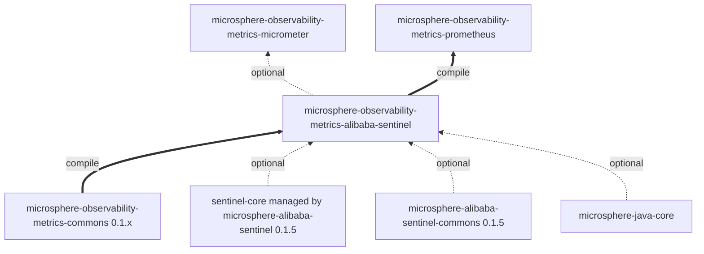
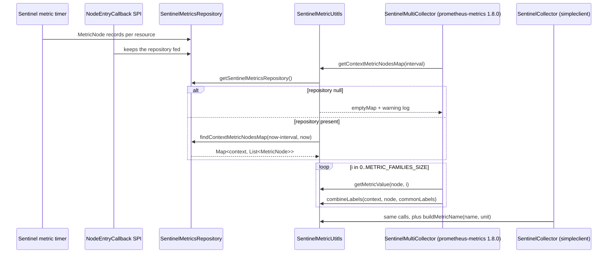
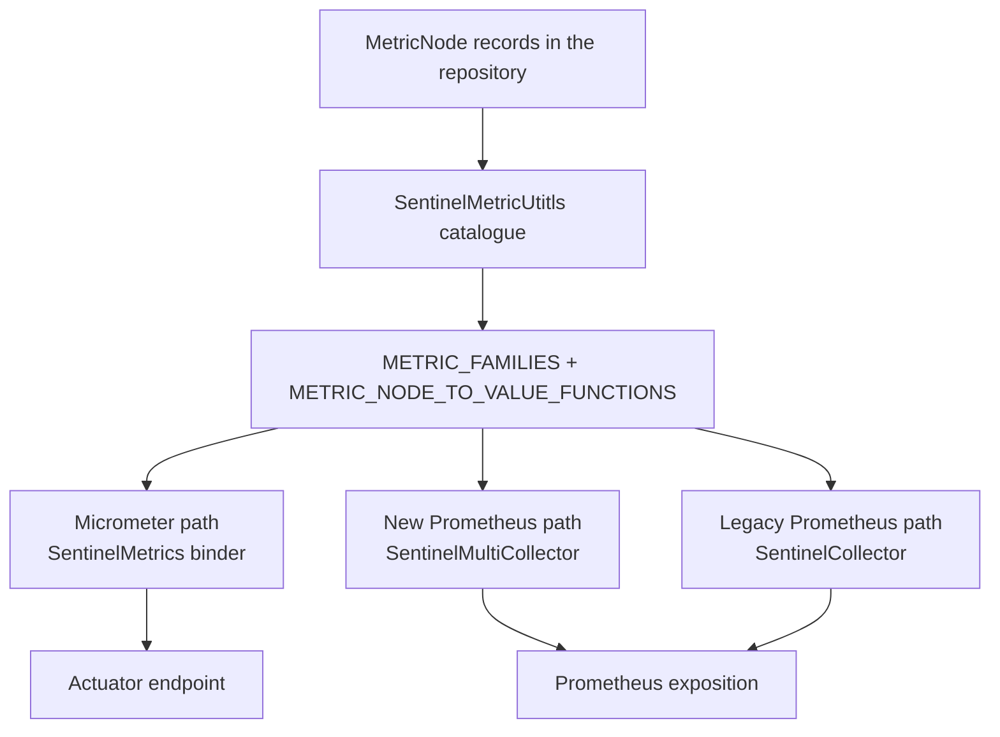

# metrics-alibaba-sentinel — Developer Guide (1.x line)

[中文版](./zh/metrics-alibaba-sentinel.md) · [Developer Guide index](./README.md)

## Module position

`microsphere-observability-metrics-alibaba-sentinel` is reactor module #5 on `release-1.x` (immediately after
`metrics-commons`), packaging `jar`, parent `microsphere-observability-parent:${revision}`.

| Attribute | Value |
|:---|:---|
| Branch analysed | `release-1.x` |
| Reactor version | `${revision}` = `0.1.4-SNAPSHOT` (latest released tag `0.1.3`) |
| `java.version` | not declared by the 1.x reactor pom; inherited from `microsphere-spring-cloud-parent:0.1.26` |
| Module sources | byte-identical to `origin/release` |
| Module pom | byte-identical to `origin/release` |
| Test sources | `constants/SentinelMetricsConstantsTest`, `util/SentinelMetricUtitlsTest` |

The module owns the Sentinel metric catalogue and its extraction rules; `metrics-micrometer` and `metrics-prometheus`
own the export paths. On the 1.x line there are *three* export paths in practice, because Prometheus is rendered both by
the new client and by the legacy `simpleclient` API.



The asymmetry to remember: `metrics-micrometer` depends on this module in **optional** scope, `metrics-prometheus` in
**compile** scope.

## Architecture

| Package | Types | Responsibility |
|:---|:---|:---|
| `io.microsphere.metrics.sentinel.constants` | `SentinelMetricsConstants` | Metric names and label names, all under `PREFIX = "sentinel_"` |
| `io.microsphere.metrics.sentinel.util` | `SentinelMetricUtitls` | The 7-family catalogue, the 4 required labels, `MetricNode` readers, and the repository time-window query |

No service, no bean, no lifecycle; every member is statically reachable, so the renderers can call it from any thread.
The design is identical on both version lines — the catalogue is what allows 0.1.x to serve two Prometheus client APIs
from one definition.

## Dependency relationships

| Dependency | Scope | Purpose | `release-1.x` version |
|:---|:---|:---|:---|
| `microsphere-observability-metrics-commons` | compile | `MetricFamily`, `MetricType` | `${revision}` |
| `com.alibaba.csp:sentinel-core` | optional | `MetricNode`, `Constants.SENTINEL_VERSION` | managed by BOM `0.1.5` |
| `microsphere-alibaba-sentinel-commons` | optional | `SentinelMetricsRepository`, `SentinelUtils.getResourceTypeAsString`, `ProcessorSlotCallbackUtils` | `0.1.5` |
| `microsphere-java-core` | optional | `Utils`, `Logger`/`LoggerFactory`, `ListUtils`/`MapUtils`, `StringUtils` | 0.1.x line |
| `microsphere-annotation-processor` | optional | build-time annotation processing | 0.1.x line |
| `org.junit.jupiter:junit-jupiter` | test | assertions | JUnit BOM `5.14.4` |
| `microsphere-java-test`, `logback-classic` | test | test support and logging | 0.1.x line |

## Source analysis

### `SentinelMetricsConstants.java`

`microsphere-observability-metrics-alibaba-sentinel/src/main/java/io/microsphere/metrics/sentinel/constants/SentinelMetricsConstants.java`

- `PREFIX = "sentinel_"` (line 33) is concatenated into every other constant, so a prefix change renames the entire
  namespace.
- Label names: `ORIGIN_LABEL_NAME` (38), `RESOURCE_LABEL_NAME` (43), `CONTEXT_LABEL_NAME` (48),
  `RESOURCE_TYPE_LABEL_NAME` (53), `VERSION_LABEL_NAME` (58), `TIMESTAMP_LABEL_NAME` (63).
- Metric names: `RT_METRIC_NAME` (68), `CONCURRENCY_METRIC_NAME` (73), `SUCCESS_QPS_METRIC_NAME` (78),
  `PASS_QPS_METRIC_NAME` (83), `OCCUPIED_PASS_QPS_METRIC_NAME` (88), `BLOCK_QPS_METRIC_NAME` (93),
  `EXCEPTION_QPS_METRIC_NAME` (98).
- `ORIGIN_LABEL_NAME` is not part of `REQUIRED_LABEL_NAMES`; `TIMESTAMP_LABEL_NAME` is appended by
  `SentinelMultiCollector.toLabels(...)`
  (`microsphere-observability-metrics-prometheus/src/main/java/io/microsphere/metrics/prometheus/sentinel/SentinelMultiCollector.java:142`)
  and is *not* appended on the legacy path, where the timestamp travels as the sample timestamp instead
  (`…/sentinel/client/SentinelCollector.java:135`). On the 1.x line this difference is user-visible in the exposition
  format, so both consumers must be considered when touching these constants.
- Declared as an `interface` of `String` constants — the classic constant-holder idiom.

### `SentinelMetricUtitls.java`

`microsphere-observability-metrics-alibaba-sentinel/src/main/java/io/microsphere/metrics/sentinel/util/SentinelMetricUtitls.java`

`public abstract class SentinelMetricUtitls implements Utils` (line 64) with a private constructor (line 224).

- `REQUIRED_LABEL_NAME_TO_VALUE_FUNCTION_MAP` (lines 68-73): private static
  `Map<String, BiFunction<String, MetricNode, String>>` built with `MapUtils.of(...)`; four entries —
  `resource → MetricNode::getResource`, `context → the argument`,
  `resource_type → SentinelUtils.getResourceTypeAsString(metricNode.getClassification())`,
  `version → Constants.SENTINEL_VERSION`.
- `REQUIRED_LABEL_NAMES` (line 78): the map's `keySet()` — a live view, so label order and label set cannot drift from
  the extractor table.
- `METRIC_FAMILIES` (lines 83-91): seven `MetricFamily` instances, all `GAUGE`, all sharing the same label-set reference;
  only `sentinel_rt` carries a unit (`millseconds`). Index 6's help text duplicates index 5's ("The Block QPS …").
- `METRIC_NODE_TO_VALUE_FUNCTIONS` (lines 96-104): seven method references index-aligned with the families
  (`getRt`, `getConcurrency`, `getSuccessQps`, `getPassQps`, `getOccupiedPassQps`, `getBlockQps`, `getExceptionQps`).
- `REQUIRED_LABEL_NAMES_SIZE` (109) and `METRIC_FAMILIES_SIZE` (114): precomputed sizes so renderers can loop without
  re-deriving them.
- `getContextMetricNodesMap(long interval)` (lines 154-165): resolves `SentinelMetricsRepository.getSentinelMetricsRepository()`
  at call time; `null` → warning log + `Collections.emptyMap()`; otherwise
  `findContextMetricNodesMap(now - interval, now)`.
- `combineLabels(String, MetricNode, Map<String, String>)` (lines 174-179): fixed-capacity linked hash map,
  common labels first then required labels, so required labels win on collision and iteration order stays stable for
  `Labels.of(keys, values)` / `new Sample(name, labelNames, labelValues, …)`.
- `getRequiredLabels(String, MetricNode)` (lines 188-195): returns `unmodifiableMap(...)` — a defensive read-only view.
- `getRequiredLabelValue(String, String, MetricNode)` (lines 206-208): map lookup then apply; documented and tested to
  throw `NullPointerException` for an unknown label name.
- `getMetricValue(MetricNode, int)` (lines 219-222): `IndexOutOfBoundsException` outside `0..6`, `NullPointerException`
  for a `null` node, returns `doubleValue()`.

## Design patterns

| Pattern | Where | Rationale |
|:---|:---|:---|
| Utility class, instantiation-proof | `abstract … implements Utils` + private constructor (64, 224) | Stateless catalogue access from any thread |
| Constant namespace holder | `SentinelMetricsConstants` interface | One prefix; no literals spread across three modules |
| Catalogue-as-data | `METRIC_FAMILIES`, `METRIC_NODE_TO_VALUE_FUNCTIONS` | Renderers iterate instead of branching; on 1.x it is the single definition feeding two Prometheus client APIs |
| Positional strategy (parallel arrays) | family list ↔ reader list index alignment | Separates metadata from extraction without a class per metric |
| Function table | `REQUIRED_LABEL_NAME_TO_VALUE_FUNCTION_MAP` (68-73) | Label set derived from the extractor map |
| Null object / graceful degradation | `emptyMap()` when the repository is absent (158) | Scrape time reports "no metrics", never an exception |
| Read-only view | `unmodifiableMap` (194), `keySet()` (78) | Static state published without exposing mutability |

## Key flows





The index alignment is the load-bearing invariant: if the two lists ever disagree in order or length, values are attached
to the wrong names silently. `SentinelMetricUtitlsTest#testConstants` guards it by asserting both sizes and every family
name by index.

## Build and test

```bash
# unit + module tests with the default profile (Boot 2.6.15 / Cloud 2021.0.9)
./mvnw -pl microsphere-observability-metrics-alibaba-sentinel test

# explicitly against an older generation
./mvnw -pl microsphere-observability-metrics-alibaba-sentinel test -P spring-cloud-hoxton
```

| Test | Covers |
|:---|:---|
| `constants/SentinelMetricsConstantsTest` | Constant values |
| `util/SentinelMetricUtitlsTest` | Catalogue contents and order, the `buildMetricName` unit-suffix rule, label extraction (`COMMON_WEB`), `combineLabels` merge order, repository-not-ready → `emptyMap`, and the declared `NullPointerException` / `IndexOutOfBoundsException` contracts |

`testGetContextMetricNodesMap` runs Sentinel in-process: 100 `SentinelTemplate.call(resource, () -> sleep(10))`
invocations, the repository installed by `addEntryCallback(...)`, polling `getContextMetricNodesMap(60000)` until it is
non-empty, and `removeEntryCallback(...)` in a `finally`. No database, container or external service is required; CI on
this branch runs only the Maven build and publish workflows.

## Extension points

- **New Sentinel metric**: add the name constant, add the `MetricFamily` to `METRIC_FAMILIES` **and** the reader to
  `METRIC_NODE_TO_VALUE_FUNCTIONS` at the same index, then update `SentinelMetricUtitlsTest`.
- **New label**: one entry in `REQUIRED_LABEL_NAME_TO_VALUE_FUNCTION_MAP`; `REQUIRED_LABEL_NAMES` follows automatically.
- **On this line, every catalogue change has three consumers** — `SentinelMetrics` (Micrometer), `SentinelMultiCollector`
  (new client) and `SentinelCollector` (legacy client). `metrics-spring-cloud` also compiles against `simpleclient` here,
  so verify all three render before declaring a naming change complete.
- The repository is resolved lazily per call, so an alternative `SentinelMetricsRepository` can be installed without
  touching this module.

## Differences from the `current` line (developer view)

| Item | `release` (0.2.x) | `release-1.x` (0.1.x) |
|:---|:---|:---|
| Module sources / pom | — | identical |
| Sentinel generation | `microsphere-alibaba-sentinel` `0.2.5` | `0.1.5` |
| JUnit BOM | 6.1.3 | 5.14.4 |
| Prometheus renderers of this catalogue | new client only (1.9.0) | new client (1.8.0) **and** legacy `simpleclient` |
| Downstream auto-config registration | `.imports` | `.imports` + `spring.factories` |

## Related documents

- [中文开发者文档](./zh/metrics-alibaba-sentinel.md)
- [Developer Guide — current / release branch](../current/metrics-alibaba-sentinel.md)
- [User Guide — metrics-alibaba-sentinel (1.x)](../../user-guide/1.x/metrics-alibaba-sentinel.md)
- [Developer Guide index for this branch](./README.md)
