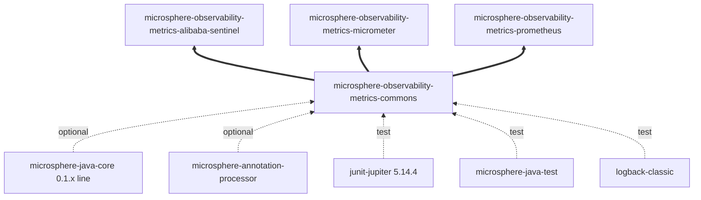
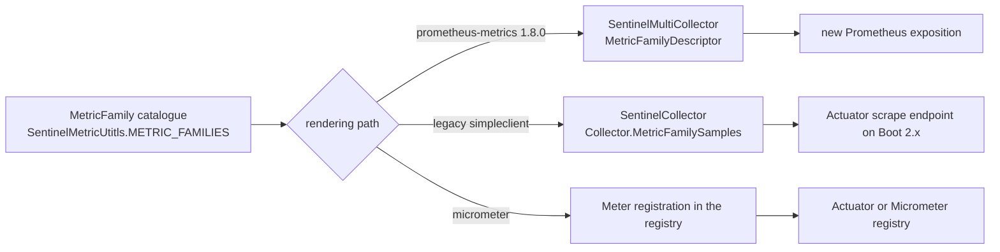

# metrics-commons — Developer Guide (1.x line)

[中文版](./zh/metrics-commons.md) · [Developer Guide index](./README.md)

## Module position

On `release-1.x` the reactor has the **same 12 modules in the same order** as `release`; `metrics-commons` is still
module #4. Nothing about this module's position changes between the two lines.

| Attribute | Value |
|:---|:---|
| Branch analysed | `release-1.x` |
| Parent | `microsphere-observability-parent:${revision}` |
| Packaging | `jar` |
| Reactor version | `${revision}` = `0.1.4-SNAPSHOT` (latest released tag `0.1.3`) |
| `java.version` | not declared by the 1.x reactor root pom (the `release` branch declares `17`) |
| Sources | byte-identical to `origin/release` — `git diff` reports no changed file under this module |
| Test sources | none |

The absence of `java.version` means the language level is inherited from
`io.github.microsphere-projects:microsphere-spring-cloud-parent:0.1.26`. The two types in this module use only
`java.util.Set`, `java.util.List` and generics, so they compile on any level the 1.x line targets.

## Architecture

One package, `io.microsphere.metrics.commons`, two public types (`MetricFamily`, `MetricType`). The module owns
*metric vocabulary* and no behaviour, which is why the `0.1.x` and `0.2.x` lines can share it unchanged: the difference
between the lines lives in the rendering modules, not here.

| Package | Types | Responsibility |
|:---|:---|:---|
| `io.microsphere.metrics.commons` | `MetricFamily`, `MetricType` | Backend-neutral metric family descriptor shared by the Sentinel, Micrometer and Prometheus modules |

## Dependency relationships



The module's declared dependencies are the same five as on `release` (2 optional compile, 3 test); what differs on this
line is the *resolved* generation of everything around it — `microsphere-spring-cloud` `0.1.26`,
`microsphere-alibaba-sentinel` `0.1.5`, `microsphere-i18n` `0.1.21`, `prometheus-metrics-bom` `1.8.0`, JUnit `5.14.4`
(from the parent, vs `6.1.3` on the `release` line).

## Source analysis

Identical to the `release` branch; the line numbers below are the same on `origin/release-1.x`.

### `MetricType.java`

`microsphere-observability-metrics-commons/src/main/java/io/microsphere/metrics/commons/MetricType.java`

- 7 constants: `COUNTER`, `GAUGE`, `HISTOGRAM`, `SUMMARY`, `INFO`, `STATESET`, `UNKNOWN` (lines 31-43).
- No fields, no methods; consumers map by `name()`.
- The bridge that matters on this line is
  `io.prometheus.metrics.model.registry.MetricType.valueOf(type.name())` in `SentinelMultiCollector` (line 166), against
  **prometheus-metrics 1.8.0**, plus a second, legacy rendering path: `metrics-prometheus` also ships
  `io.microsphere.metrics.prometheus.sentinel.client.SentinelCollector` built on `io.prometheus:simpleclient`, and
  `metrics-spring-cloud` on this branch depends on `simpleclient` rather than `prometheus-metrics-core`. `MetricType`
  therefore has to stay name-compatible with two client generations at once.

### `MetricFamily.java`

`microsphere-observability-metrics-commons/src/main/java/io/microsphere/metrics/commons/MetricFamily.java`

- 5 `final` fields (lines 32-40); package-private constructor (line 42); plain getters (lines 50-68).
- `builder()` (line 70) → `Builder` (lines 74-110): fluent, unchecked, `build()` forwards to the constructor and never
  returns `null`.
- `getLabelNames()` returns the supplied set by reference; no `equals`/`hashCode`/`toString`.

## Design patterns

| Pattern | Where | Note for the 1.x line |
|:---|:---|:---|
| Builder | `MetricFamily.Builder` | Same catalogue style as `SentinelMetricUtitls.METRIC_FAMILIES` on both lines |
| Immutable value object (partial) | `MetricFamily` fields + package-private constructor | Shared-as-is across the 0.1.x Prometheus client split |
| Named type / enum catalogue | `MetricType` | Must remain name-compatible with both `prometheus-metrics` 1.8.0 and legacy `simpleclient` type names |
| javadoc alignment markers | `@see` targets in both types | The `@since` tags still read `1.0.0` |

## Key flows



The 1.x line is where the descriptor model has to serve two Prometheus client APIs simultaneously; that is the concrete
reason the descriptor carries no client types and no behaviour.

## Build and test

```bash
# build with the default profile (Spring Boot 2.6.15 / Spring Cloud 2021.0.9)
./mvnw -pl microsphere-observability-metrics-commons -am package

# pick an older generation explicitly
./mvnw -pl microsphere-observability-metrics-commons -am package -P spring-cloud-hoxton
```

No test sources exist in the module, so `test` is a no-op; behaviour is exercised through
`SentinelMetricUtitlsTest` in `metrics-alibaba-sentinel` (whose sources are also identical between the branches).
JUnit on this line resolves to the `5.14.4` BOM from the parent, and the CI on `release-1.x` runs the same Maven build
workflow without the wiki-publish and merge-to-branches workflows that exist on `release`.

## Extension points

- Adding a `MetricType` constant on this line requires checking both client generations
  (`io.prometheus.metrics.model.registry.MetricType` at 1.8.0 and `io.prometheus.client.Collector.Type`) before the
  Prometheus paths can render it.
- Catalogues continue to follow the `METRIC_FAMILIES` + `METRIC_FAMILIES_SIZE` + `getMetricFamily(int)` convention that
  `SentinelMultiCollector` and `SentinelCollector` iterate.
- Keep behaviour out of this module; the 1.x code base needs it to stay the common denominator of two Prometheus client
  APIs and a Micrometer binder stack.

## Differences from the `current` line (developer view)

| Item | `release` (0.2.x) | `release-1.x` (0.1.x) |
|:---|:---|:---|
| Module sources | — | identical |
| Module pom | — | identical |
| Prometheus client rendered | `prometheus-metrics-bom` 1.9.0 | `prometheus-metrics-bom` 1.8.0 + legacy `simpleclient` in use |
| JUnit BOM | 6.1.3 | 5.14.4 |
| Reactor `java.version` | `17` | not declared |
| Auto-configuration registration downstream | `.imports` only | `.imports` + `META-INF/spring.factories` |

## Related documents

- [中文开发者文档](./zh/metrics-commons.md)
- [Developer Guide — current / release branch](../current/metrics-commons.md)
- [User Guide — metrics-commons (1.x)](../../user-guide/1.x/metrics-commons.md)
- [Developer Guide index for this branch](./README.md)
