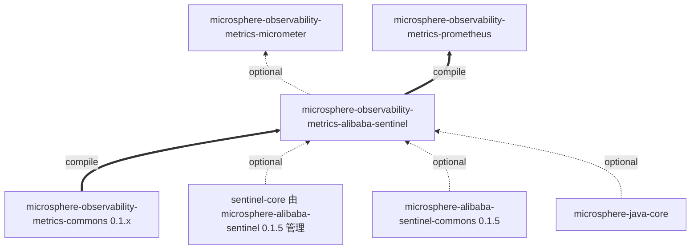
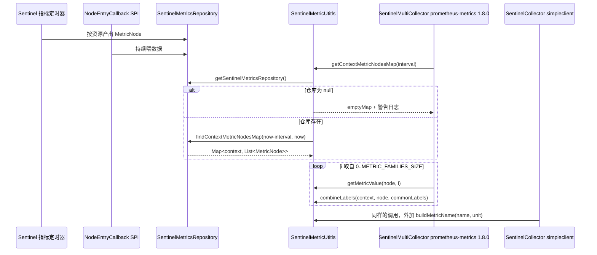
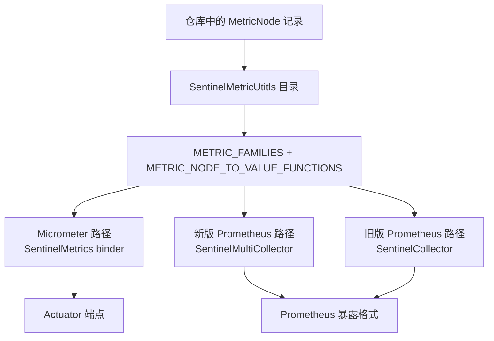

# metrics-alibaba-sentinel 开发者文档（1.x 版本线）

[English version](../metrics-alibaba-sentinel.md) · [开发者文档索引](./README.md)

## 模块定位

`microsphere-observability-metrics-alibaba-sentinel` 是 `release-1.x` 分支 reactor 的第 5 个模块（紧跟
`metrics-commons`），打包方式 `jar`，父工程 `microsphere-observability-parent:${revision}`。

| 属性 | 值 |
|:---|:---|
| 分析分支 | `release-1.x` |
| reactor 版本 | `${revision}` = `0.1.4-SNAPSHOT`（最新已发布标签 `0.1.3`） |
| `java.version` | 1.x reactor pom 未声明，继承自 `microsphere-spring-cloud-parent:0.1.26` |
| 模块源码 | 与 `origin/release` 逐字节一致 |
| 模块 pom | 与 `origin/release` 逐字节一致 |
| 测试源码 | `constants/SentinelMetricsConstantsTest`、`util/SentinelMetricUtitlsTest` |

本模块拥有 Sentinel 指标目录及其抽取规则，导出路径由 `metrics-micrometer` 与 `metrics-prometheus` 承担。在 1.x 版本线上
实际上存在**三条**导出路径，因为 Prometheus 侧同时由新客户端和旧版 `simpleclient` API 渲染。



需要记住的不对称：`metrics-micrometer` 以 **optional** 作用域依赖本模块，`metrics-prometheus` 以 **compile** 作用域依赖。

## 架构设计

| 包 | 类型 | 职责 |
|:---|:---|:---|
| `io.microsphere.metrics.sentinel.constants` | `SentinelMetricsConstants` | 指标名与标签名，统一位于 `PREFIX = "sentinel_"` 之下 |
| `io.microsphere.metrics.sentinel.util` | `SentinelMetricUtitls` | 7 个指标族的目录、4 个必需标签、`MetricNode` 读取方法、仓库时间窗查询 |

没有服务、没有 bean、没有生命周期，所有成员均可静态访问，因此渲染器可以在任意线程调用。两条版本线的设计完全一致——
目录式设计正是 0.1.x 能够用一份定义同时服务两套 Prometheus 客户端 API 的原因。

## 依赖关系

| 依赖 | 作用域 | 用途 | `release-1.x` 版本 |
|:---|:---|:---|:---|
| `microsphere-observability-metrics-commons` | compile | `MetricFamily`、`MetricType` | `${revision}` |
| `com.alibaba.csp:sentinel-core` | optional | `MetricNode`、`Constants.SENTINEL_VERSION` | 由 BOM `0.1.5` 管理 |
| `microsphere-alibaba-sentinel-commons` | optional | `SentinelMetricsRepository`、`SentinelUtils.getResourceTypeAsString`、`ProcessorSlotCallbackUtils` | `0.1.5` |
| `microsphere-java-core` | optional | `Utils`、`Logger`/`LoggerFactory`、`ListUtils`/`MapUtils`、`StringUtils` | 0.1.x 线 |
| `microsphere-annotation-processor` | optional | 构建期注解处理 | 0.1.x 线 |
| `org.junit.jupiter:junit-jupiter` | test | 断言 | JUnit BOM `5.14.4` |
| `microsphere-java-test`、`logback-classic` | test | 测试支持与日志 | 0.1.x 线 |

## 源码分析

### `SentinelMetricsConstants.java`

`microsphere-observability-metrics-alibaba-sentinel/src/main/java/io/microsphere/metrics/sentinel/constants/SentinelMetricsConstants.java`

- `PREFIX = "sentinel_"`（第 33 行）被拼接进其它所有常量，因此改前缀就等于重命名整个命名空间。
- 标签名：`ORIGIN_LABEL_NAME`（38）、`RESOURCE_LABEL_NAME`（43）、`CONTEXT_LABEL_NAME`（48）、
  `RESOURCE_TYPE_LABEL_NAME`（53）、`VERSION_LABEL_NAME`（58）、`TIMESTAMP_LABEL_NAME`（63）。
- 指标名：`RT_METRIC_NAME`（68）、`CONCURRENCY_METRIC_NAME`（73）、`SUCCESS_QPS_METRIC_NAME`（78）、
  `PASS_QPS_METRIC_NAME`（83）、`OCCUPIED_PASS_QPS_METRIC_NAME`（88）、`BLOCK_QPS_METRIC_NAME`（93）、
  `EXCEPTION_QPS_METRIC_NAME`（98）。
- `ORIGIN_LABEL_NAME` 不在 `REQUIRED_LABEL_NAMES` 中；`TIMESTAMP_LABEL_NAME` 由 `SentinelMultiCollector.toLabels(...)`
  追加（`microsphere-observability-metrics-prometheus/src/main/java/io/microsphere/metrics/prometheus/sentinel/SentinelMultiCollector.java:142`），
  而在旧版路径上不追加，时间戳改由样本时间戳承载（`…/sentinel/client/SentinelCollector.java:135`）。在 1.x 版本线上这一
  差异对暴露格式是可见的，因此改动这些常量时必须同时考虑两个使用方。
- 以持有 `String` 常量的 `interface` 形式声明——经典的常量持有者写法。

### `SentinelMetricUtitls.java`

`microsphere-observability-metrics-alibaba-sentinel/src/main/java/io/microsphere/metrics/sentinel/util/SentinelMetricUtitls.java`

`public abstract class SentinelMetricUtitls implements Utils`（第 64 行），构造器私有（第 224 行）。

- `REQUIRED_LABEL_NAME_TO_VALUE_FUNCTION_MAP`（第 68-73 行）：私有静态
  `Map<String, BiFunction<String, MetricNode, String>>`，由 `MapUtils.of(...)` 构造，四项——
  `resource → MetricNode::getResource`、`context → 入参`、
  `resource_type → SentinelUtils.getResourceTypeAsString(metricNode.getClassification())`、
  `version → Constants.SENTINEL_VERSION`。
- `REQUIRED_LABEL_NAMES`（第 78 行）：该映射的 `keySet()`，是活动视图，因此标签集合与标签顺序不可能与取值表脱节。
- `METRIC_FAMILIES`（第 83-91 行）：7 个 `MetricFamily`，全部 `GAUGE`，共享同一标签集合引用；只有 `sentinel_rt` 带单位
  （`millseconds`）。索引 6 的 help 文本与索引 5 重复（“The Block QPS …”）。
- `METRIC_NODE_TO_VALUE_FUNCTIONS`（第 96-104 行）：与指标族按索引对齐的 7 个方法引用
  （`getRt`、`getConcurrency`、`getSuccessQps`、`getPassQps`、`getOccupiedPassQps`、`getBlockQps`、`getExceptionQps`）。
- `REQUIRED_LABEL_NAMES_SIZE`（109）与 `METRIC_FAMILIES_SIZE`（114）：预算好的长度常量，使渲染器无需自行推算。
- `getContextMetricNodesMap(long interval)`（第 154-165 行）：调用时解析
  `SentinelMetricsRepository.getSentinelMetricsRepository()`；为 `null` 时输出警告日志并返回
  `Collections.emptyMap()`；否则调用 `findContextMetricNodesMap(now - interval, now)`。
- `combineLabels(String, MetricNode, Map<String, String>)`（第 174-179 行）：固定容量链表 hash map，先公共标签再必需标签，
  因此冲突时必需标签胜出，且遍历顺序对 `Labels.of(keys, values)` /
  `new Sample(name, labelNames, labelValues, …)` 保持稳定。
- `getRequiredLabels(String, MetricNode)`（第 188-195 行）：返回 `unmodifiableMap(...)`，防御式只读视图。
- `getRequiredLabelValue(String, String, MetricNode)`（第 206-208 行）：查表后应用函数；javadoc 与测试均确认未知标签名抛
  `NullPointerException`。
- `getMetricValue(MetricNode, int)`（第 219-222 行）：索引超出 `0..6` 抛 `IndexOutOfBoundsException`，节点为 `null` 抛
  `NullPointerException`，返回 `doubleValue()`。

## 设计模式

| 模式 | 位置 | 动机 |
|:---|:---|:---|
| 工具类（禁止实例化） | `abstract … implements Utils` + 私有构造器（64、224） | 任意线程无状态访问目录 |
| 常量命名空间持有者 | `SentinelMetricsConstants` 接口 | 一个前缀；避免三个字模块里的字面量 |
| 目录即数据 | `METRIC_FAMILIES`、`METRIC_NODE_TO_VALUE_FUNCTIONS` | 渲染器遍历而非分支；在 1.x 上它是同时喂给两套 Prometheus 客户端 API 的唯一份定义 |
| 按位置的策略（平行数组） | 指标族列表 ↔ 读取器列表的索引对齐 | 元数据与抽取逻辑分离且无需每个指标一个类 |
| 函数表 | `REQUIRED_LABEL_NAME_TO_VALUE_FUNCTION_MAP`（68-73） | 标签集合由取值表派生 |
| 空对象 / 优雅降级 | 仓库缺失时返回 `emptyMap()`（158） | 抓取时表现为“无指标”，绝不抛异常 |
| 只读视图 | `unmodifiableMap`（194）、`keySet()`（78） | 暴露静态状态但不交出可变引用 |

## 关键流程





索引对齐是承重不变式：两个列表一旦顺序或长度不一致，数值会被静默挂到错误的指标名上。
`SentinelMetricUtitlsTest#testConstants` 通过断言两个长度以及每个索引上的指标族名称来守护它。

## 构建与测试

```bash
# 默认 profile（Boot 2.6.15 / Cloud 2021.0.9）下运行测试
./mvnw -pl microsphere-observability-metrics-alibaba-sentinel test

# 显式指定更旧的 Spring 世代
./mvnw -pl microsphere-observability-metrics-alibaba-sentinel test -P spring-cloud-hoxton
```

| 测试 | 覆盖内容 |
|:---|:---|
| `constants/SentinelMetricsConstantsTest` | 常量取值 |
| `util/SentinelMetricUtitlsTest` | 目录内容与顺序、`buildMetricName` 的单位后缀规则、标签抽取（`COMMON_WEB`）、`combineLabels` 合并顺序、仓库未就绪返回 `emptyMap`，以及已声明的 `NullPointerException` / `IndexOutOfBoundsException` 契约 |

`testGetContextMetricNodesMap` 在进程内运行 Sentinel：100 次
`SentinelTemplate.call(resource, () -> sleep(10))`，通过 `addEntryCallback(...)` 安装仓库，轮询
`getContextMetricNodesMap(60000)` 直到非空，并在 `finally` 中 `removeEntryCallback(...)`。不需要数据库、容器或外部服务；
本分支的 CI 只运行 Maven 构建与发布工作流。

## 扩展点

- **新增 Sentinel 指标**：追加名称常量，在 `METRIC_FAMILIES` 追加指标族，并在 `METRIC_NODE_TO_VALUE_FUNCTIONS` 的
  **同一索引**追加读取方法，然后更新 `SentinelMetricUtitlsTest`。
- **新增标签**：在 `REQUIRED_LABEL_NAME_TO_VALUE_FUNCTION_MAP` 增加一项，`REQUIRED_LABEL_NAMES` 自动跟随。
- **在本版本线上，每次目录改动牵涉三个使用方**——`SentinelMetrics`（Micrometer）、`SentinelMultiCollector`（新客户端）
  与 `SentinelCollector`（旧客户端）。此外 1.x 的 `metrics-spring-cloud` 仍编译在 `simpleclient` 之上，因此命名改动必须
  先验证这三条渲染路径。
- 仓库是每次调用时惰性解析的，因此可以在不改动本模块的前提下替换 `SentinelMetricsRepository`。

## 与 `current` 版本线的差异（开发者视角）

| 项目 | `release`（0.2.x） | `release-1.x`（0.1.x） |
|:---|:---|:---|
| 模块源码 / pom | — | 完全一致 |
| Sentinel 世代 | `microsphere-alibaba-sentinel` `0.2.5` | `0.1.5` |
| JUnit BOM | 6.1.3 | 5.14.4 |
| 本目录的 Prometheus 渲染器 | 仅新客户端（1.9.0） | 新客户端（1.8.0）**且**旧版 `simpleclient` |
| 下游自动配置注册 | `.imports` | `.imports` + `spring.factories` |

## 相关文档

- [English Developer Guide](../metrics-alibaba-sentinel.md)
- [开发者文档 —— current / release 分支](../current/zh/metrics-alibaba-sentinel.md)
- [用户文档 —— metrics-alibaba-sentinel（1.x）](../../user-guide/1.x/zh/metrics-alibaba-sentinel.md)
- [本分支开发者文档索引](./README.md)
