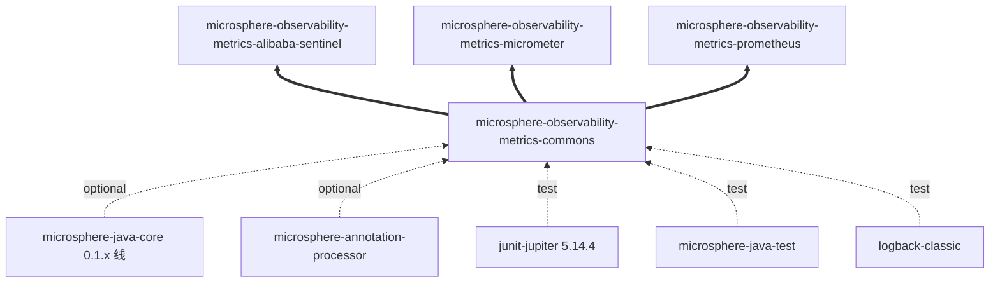
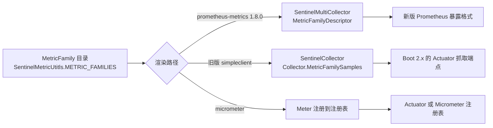

# metrics-commons 开发者文档（1.x 版本线）

[English version](../metrics-commons.md) · [开发者文档索引](./README.md)

## 模块定位

`release-1.x` 分支的 reactor 与 `release` 分支拥有**完全相同的 12 个模块、完全相同的顺序**，`metrics-commons` 仍是第 4 个。
本模块在两条版本线中的位置没有任何变化。

| 属性 | 值 |
|:---|:---|
| 分析分支 | `release-1.x` |
| 父工程 | `microsphere-observability-parent:${revision}` |
| 打包方式 | `jar` |
| reactor 版本 | `${revision}` = `0.1.4-SNAPSHOT`（最新已发布标签 `0.1.3`） |
| `java.version` | 1.x reactor 根 pom 未声明（`release` 分支声明为 `17`） |
| 源码 | 与 `origin/release` 逐字节一致——`git diff` 在本模块目录下无变更文件 |
| 测试源码 | 无 |

未声明 `java.version` 意味着语言级别继承自
`io.github.microsphere-projects:microsphere-spring-cloud-parent:0.1.26`。本模块两个类型只用到 `java.util.Set`、
`java.util.List` 与泛型，在 1.x 所指向的任意语言级别上都能编译。

## 架构设计

一个包 `io.microsphere.metrics.commons`，两个公开类型（`MetricFamily`、`MetricType`）。本模块拥有*指标词汇*而不拥有行为，
这正是 `0.1.x` 与 `0.2.x` 可以原样共享它的原因：两条版本线的差异体现在渲染模块，而非这里。

| 包 | 类型 | 职责 |
|:---|:---|:---|
| `io.microsphere.metrics.commons` | `MetricFamily`、`MetricType` | 与后端无关的指标族描述符，被 Sentinel、Micrometer、Prometheus 模块共享 |

## 依赖关系



本模块声明的依赖与 `release` 上的 5 项完全相同（2 个 optional 编译依赖、3 个 test 依赖）；不同之处在于它周围一切
*被解析到的世代*——`microsphere-spring-cloud` `0.1.26`、`microsphere-alibaba-sentinel` `0.1.5`、`microsphere-i18n` `0.1.21`、
`prometheus-metrics-bom` `1.8.0`、JUnit `5.14.4`（来自父工程，`release` 线为 `6.1.3`）。

## 源码分析

与 `release` 分支完全一致；下列行号在 `origin/release-1.x` 上同样成立。

### `MetricType.java`

`microsphere-observability-metrics-commons/src/main/java/io/microsphere/metrics/commons/MetricType.java`

- 7 个常量：`COUNTER`、`GAUGE`、`HISTOGRAM`、`SUMMARY`、`INFO`、`STATESET`、`UNKNOWN`（第 31-43 行）。
- 无字段、无方法；使用者只能通过 `name()` 映射。
- 在本版本线上关键的桥接是 `SentinelMultiCollector` 中的
  `io.prometheus.metrics.model.registry.MetricType.valueOf(type.name())`（第 166 行），面向 **prometheus-metrics 1.8.0**；
  另外还有第二条旧版渲染路径：`metrics-prometheus` 中的
  `io.microsphere.metrics.prometheus.sentinel.client.SentinelCollector` 继承自 `io.prometheus.client.Collector`
  （旧版 `simpleclient` API），并在其中使用 `Collector.Type.valueOf(...)`（第 105 行）。同时 1.x 的
  `metrics-spring-cloud` 依赖的是 `simpleclient` 而不是 `prometheus-metrics-core`。因此 `MetricType` 必须同时对两代
  Prometheus 客户端保持名称兼容。

### `MetricFamily.java`

`microsphere-observability-metrics-commons/src/main/java/io/microsphere/metrics/commons/MetricFamily.java`

- 5 个 `final` 字段（第 32-40 行）；包级私有构造器（第 42 行）；朴素 getter（第 50-68 行）。
- `builder()`（第 70 行）→ `Builder`（第 74-110 行）：链式、无校验，`build()` 转调构造器且永不返回 `null`。
- `getLabelNames()` 按引用返回传入的 Set；没有 `equals`/`hashCode`/`toString`。

## 设计模式

| 模式 | 位置 | 1.x 版本线的说明 |
|:---|:---|:---|
| 建造者（Builder） | `MetricFamily.Builder` | 两条版本线使用同一套目录写法（`SentinelMetricUtitls.METRIC_FAMILIES`） |
| 不可变值对象（部分） | `MetricFamily` 字段 + 包级私有构造器 | 在 0.1.x 的 Prometheus 客户端新旧并存局面下被原样共享 |
| 具名类型 / 枚举目录 | `MetricType` | 必须同时兼容 `prometheus-metrics` 1.8.0 与旧版 `simpleclient` 的类型名 |
| javadoc 对齐标记 | 两个类型中的 `@see` | `@since` 仍标注为 `1.0.0` |

## 关键流程



1.x 版本线正是描述符模型必须同时服务两代 Prometheus 客户端 API 的地方；这就是描述符不携带任何客户端类型、也不携带
行为的具体原因。

## 构建与测试

```bash
# 使用默认 profile（Spring Boot 2.6.15 / Spring Cloud 2021.0.9）构建
./mvnw -pl microsphere-observability-metrics-commons -am package

# 显式选择更旧的世代
./mvnw -pl microsphere-observability-metrics-commons -am package -P spring-cloud-hoxton
```

本模块没有测试源码，`test` 阶段是空操作；其行为通过 `metrics-alibaba-sentinel` 中的 `SentinelMetricUtitlsTest`
验证（该源码在两条分支之间同样一致）。本版本线的 JUnit 解析到父工程提供的 `5.14.4` BOM，而 `release-1.x` 的 CI 只运行
Maven 构建工作流，不包含 `release` 分支上的 wiki-publish 与 merge-to-branches 工作流。

## 扩展点

- 在本版本线新增 `MetricType` 常量时，必须先确认两代客户端（`io.prometheus.metrics.model.registry.MetricType` 1.8.0 与
  `io.prometheus.client.Collector.Type`）都存在同名常量，否则 Prometheus 路径无法渲染。
- 指标目录继续沿用 `METRIC_FAMILIES` + `METRIC_FAMILIES_SIZE` + `getMetricFamily(int)` 约定，
  `SentinelMultiCollector` 与 `SentinelCollector` 都按此遍历。
- 不要把行为放进本模块：1.x 代码库需要它作为两套 Prometheus 客户端 API 与 Micrometer binder 栈之间的最小公约数。

## 与 `current` 版本线的差异（开发者视角）

| 项目 | `release`（0.2.x） | `release-1.x`（0.1.x） |
|:---|:---|:---|
| 模块源码 | — | 完全一致 |
| 模块 pom | — | 完全一致 |
| 被渲染到的 Prometheus 客户端 | `prometheus-metrics-bom` 1.9.0 | `prometheus-metrics-bom` 1.8.0，且旧版 `simpleclient` 仍在使用 |
| JUnit BOM | 6.1.3 | 5.14.4 |
| reactor `java.version` | `17` | 未声明 |
| 下游自动配置注册方式 | 仅 `.imports` | `.imports` + `META-INF/spring.factories` |

## 相关文档

- [English Developer Guide](../metrics-commons.md)
- [开发者文档 —— current / release 分支](../current/zh/metrics-commons.md)
- [用户文档 —— metrics-commons（1.x）](../../user-guide/1.x/zh/metrics-commons.md)
- [本分支开发者文档索引](./README.md)
