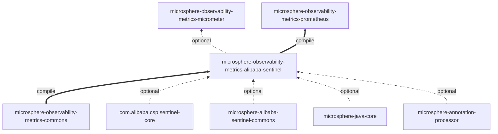
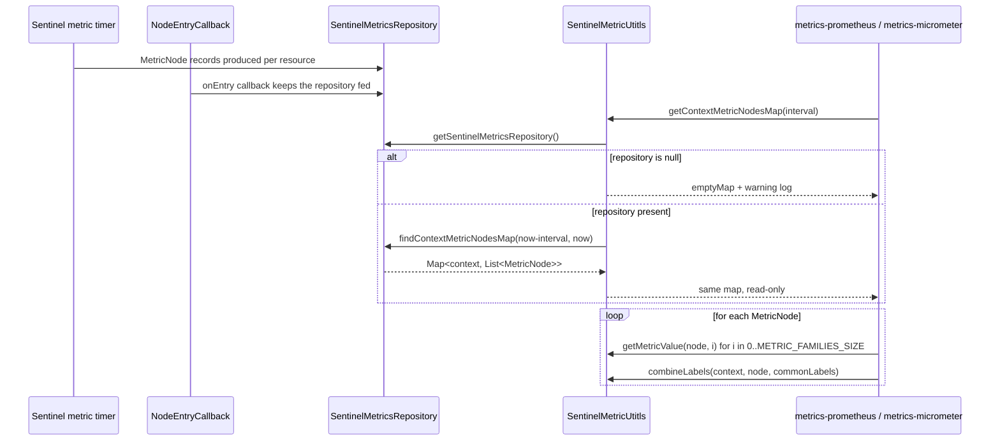
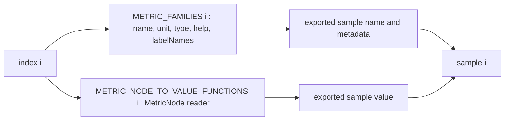

# metrics-alibaba-sentinel — Developer Guide

[中文版](./zh/metrics-alibaba-sentinel.md) · [Developer Guide index](./README.md)

## Module position

Reactor module #5 on `release` (immediately after `metrics-commons`), packaging `jar`, parent
`microsphere-observability-parent:${revision}`, version `${revision}` = `0.2.4-SNAPSHOT`.

It is the *definition* layer of the Sentinel metrics story: it owns the catalogue and the extraction rules, while
`metrics-micrometer` and `metrics-prometheus` own the two export paths. That split is what lets a new Sentinel metric be
added in exactly one place.



Note the asymmetry: `metrics-micrometer` depends on this module in **optional** scope (the Sentinel binder is a
conditional extra), while `metrics-prometheus` depends on it in **compile** scope (its only collectors are Sentinel
ones).

## Architecture

| Package | Types | Responsibility |
|:---|:---|:---|
| `io.microsphere.metrics.sentinel.constants` | `SentinelMetricsConstants` | Naming: metric names and label names, all behind `PREFIX = "sentinel_"` |
| `io.microsphere.metrics.sentinel.util` | `SentinelMetricUtitls` | Catalogue and extraction: `MetricFamily` list, required labels, `MetricNode` readers, repository window query |

There is no service, no bean, no lifecycle and no static initialisation other than the constant catalogues. Everything
is reachable statically, which is why both export paths can use it from any thread.

## Dependency relationships

| Dependency | Scope | Used for |
|:---|:---|:---|
| `microsphere-observability-metrics-commons` | compile | `MetricFamily`, `MetricType` |
| `com.alibaba.csp:sentinel-core` | optional | `MetricNode`, `Constants.SENTINEL_VERSION`, `ResourceTypeConstants` (test) |
| `io.github.microsphere-projects:microsphere-alibaba-sentinel-commons` | optional | `SentinelMetricsRepository`, `SentinelUtils.getResourceTypeAsString`, `ProcessorSlotCallbackUtils` |
| `microsphere-java-core` | optional | `Utils`, `Logger`/`LoggerFactory`, `ListUtils`/`MapUtils`, `StringUtils` |
| `microsphere-annotation-processor` | optional | build-time |
| `junit-jupiter`, `microsphere-java-test`, `logback-classic` | test | tests |

The two Sentinel-facing dependencies being optional is a structural statement: this module is *about* Sentinel but does
not force Sentinel onto a classpath. The compile-scope `metrics-commons` is the only mandatory sibling.

## Source analysis

### `SentinelMetricsConstants.java`

`…/src/main/java/io/microsphere/metrics/sentinel/constants/SentinelMetricsConstants.java`

- `PREFIX` (line 33) is composed into every other constant (`ORIGIN_LABEL_NAME` line 38 … `TIMESTAMP_LABEL_NAME`
  line 63; metric names lines 68-98), so a prefix change renames the whole namespace.
- Declared as an `interface` with `String` constants — the pre-Java-8 "constant holder" idiom; a class implementing or
  extending it would inherit the names, though nothing in the repo does.
- `ORIGIN_LABEL_NAME` (38) is defined but excluded from `REQUIRED_LABEL_NAMES`; `TIMESTAMP_LABEL_NAME` (63) is likewise
  absent from the catalogue and is appended by `SentinelMultiCollector.toLabels(...)` instead
  (`…/metrics-prometheus/…/SentinelMultiCollector.java:142`). Both are therefore *protocol* names rather than catalogue
  members — a distinction the consuming code must respect.

### `SentinelMetricUtitls.java`

`…/src/main/java/io/microsphere/metrics/sentinel/util/SentinelMetricUtitls.java`

The class is `abstract` with a private constructor (line 224) and implements `io.microsphere.util.Utils` (line 64), the
project's marker interface for utility classes.

- `REQUIRED_LABEL_NAME_TO_VALUE_FUNCTION_MAP` (lines 68-73) — a private, static `Map<String, BiFunction<String, MetricNode, String>>`
  built with `MapUtils.of(...)`, holding 4 entries. Each function ignores one of the two inputs: `resource` reads
  `MetricNode::getResource`, `context` returns the passed context string, `resource_type` converts
  `metricNode.getClassification()` through `SentinelUtils.getResourceTypeAsString(...)`, and `version` returns the
  constant `SENTINEL_VERSION` regardless of the node.
- `REQUIRED_LABEL_NAMES` (line 78) is that map's `keySet()` — a live view, not a copy, which is exactly why its
  iteration order equals the declaration order of the four label functions.
- `METRIC_FAMILIES` (lines 83-91) — 7 `MetricFamily` instances built by the `metrics-commons` builder, all `GAUGE`, all
  sharing the same `REQUIRED_LABEL_NAMES` reference. Only index 0 carries a unit (`millseconds`). Note the help strings:
  index 6 (`sentinel_exception_qps`) is labelled `"The Block QPS of the Sentinel Resource"`, duplicating index 5.
- `METRIC_NODE_TO_VALUE_FUNCTIONS` (lines 96-104) — 7 method references, positionally bound to `METRIC_FAMILIES`. This
  index alignment is the module's central invariant and is not expressed in the type system; `REQUIRED_LABEL_NAMES_SIZE`
  (109) and `METRIC_FAMILIES_SIZE` (114) exist so consumers can loop without re-deriving sizes.
- `getContextMetricNodesMap(long interval)` (lines 154-165) — resolves the repository singleton via
  `SentinelMetricsRepository.getSentinelMetricsRepository()`; on `null` it logs
  `"SentinelMetricsRepository is not ready, please check whether it is configured"` and returns `Collections.emptyMap()`.
  Otherwise it computes `endTimeMs = currentTimeMillis()` and `beginTimeMs = endTimeMs - interval` and delegates to
  `findContextMetricNodesMap(beginTimeMs, endTimeMs)`.
- `combineLabels(...)` (lines 174-179) — allocates a fixed-capacity linked hash map sized
  `REQUIRED_LABEL_NAMES_SIZE + commonLabels.size()`, inserts `commonLabels` then the required labels, and returns the
  result of `getRequiredLabels`. Required labels therefore **win** over a common label of the same name, and ordering is
  preserved for the Prometheus `Labels.of(keys, values)` call.
- `getRequiredLabels(...)` (lines 188-195) — iterates the extractor map and returns `unmodifiableMap(...)`, so callers
  get a defensive read-only snapshot.
- `getRequiredLabelValue(...)` (lines 206-208) — `MAP.get(labelName).apply(...)`; the javadoc declares
  `NullPointerException` for an unknown name and the test asserts it.
- `getMetricValue(MetricNode, int)` (lines 219-222) — looks up the positional function, applies it, `doubleValue()`.
  Declared exceptions: `IndexOutOfBoundsException`, `NullPointerException`.

## Design patterns

| Pattern | Where | Rationale |
|:---|:---|:---|
| Utility class (instantiation-proof) | `abstract class … implements Utils` + private constructor (lines 64, 224) | Stateless catalogue access from any thread |
| Constant object / namespace holder | `SentinelMetricsConstants` interface | One prefix, many names; avoids literals in three modules |
| Catalogue-as-data | `METRIC_FAMILIES`, `REQUIRED_LABEL_NAMES`, `METRIC_NODE_TO_VALUE_FUNCTIONS` | Export paths iterate a fixed list instead of branching per metric |
| Strategy by position (parallel arrays) | `METRIC_FAMILIES` ↔ `METRIC_NODE_TO_VALUE_FUNCTIONS` index alignment | Keeps metadata and extraction separate while avoiding a per-metric class |
| Function table | `REQUIRED_LABEL_NAME_TO_VALUE_FUNCTION_MAP` (lines 68-73) | Label extraction is a lookup, and the label set is derived from it, so the two can't drift |
| Graceful degradation / null object | `Collections.emptyMap()` when the repository is absent (line 158) | A missing repository yields "no metrics", never an exception at scrape time |
| Read-only view | `unmodifiableMap` (line 194), `keySet()` view (line 78) | Publishes static state without handing out a mutable copy |

## Key flows



The index-alignment invariant, which is what makes the collector loops correct:



If the two lists ever differ in order or length, values are attached to the wrong metric names silently — no exception
is raised. `SentinelMetricUtitlsTest#testConstants` is the guard: it asserts `METRIC_FAMILIES_SIZE == 7`,
`METRIC_NODE_TO_VALUE_FUNCTIONS.size() == 7` and each family name by index.

## Build and test

```bash
./mvnw -pl microsphere-observability-metrics-alibaba-sentinel test
```

Test classes (all under `src/test/java/io/microsphere/metrics/sentinel/`):

| Test | What it covers |
|:---|:---|
| `util/SentinelMetricUtitlsTest` | Catalogue contents, `buildMetricName` unit suffix rule, label extraction incl. `COMMON_WEB`, `combineLabels` merge order, the repository-not-ready empty map, and the declared `NullPointerException` / `IndexOutOfBoundsException` contracts |
| `constants/SentinelMetricsConstantsTest` | Constant values |

`SentinelMetricUtitlsTest#testGetContextMetricNodesMap` is the only test that needs live Sentinel behaviour: it issues
100 `SentinelTemplate.call(resource, () -> sleep(10))` invocations, installs the repository through
`addEntryCallback(...)`, and polls `getContextMetricNodesMap(60000)` until non-empty, always removing the callback in a
`finally`. No external service, database or container is required — Sentinel runs in-process.

## Extension points

- **Add a Sentinel metric**: append the name constant to `SentinelMetricsConstants`, append a `MetricFamily` to
  `METRIC_FAMILIES` *and* the matching `MetricNode` reader to `METRIC_NODE_TO_VALUE_FUNCTIONS` at the same index, then
  update `SentinelMetricUtitlsTest`. Both `SentinelMultiCollector` and `SentinelCollector` derive their loops from
  `METRIC_FAMILIES_SIZE`, so they pick the new metric up without modification.
- **Add a label**: put an entry in `REQUIRED_LABEL_NAME_TO_VALUE_FUNCTION_MAP`; `REQUIRED_LABEL_NAMES` follows
  automatically because it is the map's `keySet()`.
- **Change the metric namespace**: `PREFIX` only; note that `TIMESTAMP_LABEL_NAME`/`ORIGIN_LABEL_NAME` are referenced by
  the Prometheus modules by constant, so the rename stays consistent.
- **Swap the repository**: `getContextMetricNodesMap` resolves the singleton at call time, so an alternative
  `SentinelMetricsRepository` can be installed without touching this module.

## Related documents

- [中文开发者文档](./zh/metrics-alibaba-sentinel.md)
- [User Guide — metrics-alibaba-sentinel](../../user-guide/current/metrics-alibaba-sentinel.md)
- [Developer Guide — 1.x / release-1.x branch](../1.x/metrics-alibaba-sentinel.md)
- [Developer Guide index for this branch](./README.md)
