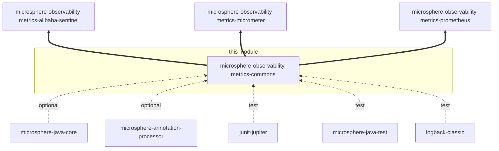

# metrics-commons — Developer Guide

[中文版](./zh/metrics-commons.md) · [Developer Guide index](./README.md)

## Module position

`microsphere-observability-metrics-commons` is module #4 of the 12-entry reactor on the `release` branch, immediately
after `microsphere-observability-logging`:

```xml
<modules>
    <module>microsphere-observability-parent</module>
    <module>microsphere-observability-dependencies</module>
    <module>microsphere-observability-logging</module>
    <module>microsphere-observability-metrics-commons</module>
    <module>microsphere-observability-metrics-alibaba-sentinel</module>
    <module>microsphere-observability-metrics-micrometer</module>
    <module>microsphere-observability-metrics-prometheus</module>
    <!-- …the Spring-facing modules -->
</modules>
```

| Attribute | Value |
|:---|:---|
| Parent | `microsphere-observability-parent:${revision}` |
| Packaging | `jar` |
| Reactor version | `${revision}` = `0.2.4-SNAPSHOT` |
| Sources analysed | `origin/release` |
| Test sources | none (the module ships no `src/test/java`) |

It is a leaf in the dependency graph: it depends on no other module of this repository, and three modules depend on it
in `compile` scope.

## Architecture

The module is one package, `io.microsphere.metrics.commons`, with two public types:

| Package | Types | Responsibility |
|:---|:---|:---|
| `io.microsphere.metrics.commons` | `MetricFamily`, `MetricType` | Describe a metric family in backend-neutral terms so downstream modules can share one catalogue |

The deliberate absence of behaviour is the design: the module owns *names, types and label schemas*, while every
backend-specific translation lives in the consumer. That is what keeps `metrics-alibaba-sentinel` able to publish a
single `METRIC_FAMILIES` list that both the Micrometer binder path and the Prometheus collector path read.

## Dependency relationships



Thick edges are inbound `compile` dependencies from sibling modules. The module's own compile classpath is empty:

| Dependency | Scope | Why it is declared |
|:---|:---|:---|
| `io.github.microsphere-projects:microsphere-annotation-processor` | optional | Build-time javadoc/annotation processing shared by all modules |
| `io.github.microsphere-projects:microsphere-java-core` | optional | Declared for symmetry with sibling modules; no type in this module imports `io.microsphere.*` |
| `org.junit.jupiter:junit-jupiter` | test | Reserved — no test sources exist yet |
| `io.github.microsphere-projects:microsphere-java-test` | test | Reserved — no test sources exist yet |
| `ch.qos.logback:logback-classic` | test | Reserved — no test sources exist yet |

Because `microsphere-java-core` is `optional`, a consumer that uses only these two data types resolves nothing extra at
runtime.

## Source analysis

### `MetricType.java`

`microsphere-observability-metrics-commons/src/main/java/io/microsphere/metrics/commons/MetricType.java`

- 7 constants in declaration order: `COUNTER` (line 31), `GAUGE` (33), `HISTOGRAM` (35), `SUMMARY` (37), `INFO` (39),
  `STATESET` (41), `UNKNOWN` (43).
- The class javadoc (lines 20-28) declares its alignment targets: the Prometheus metric-types documentation,
  `io.prometheus.metrics.model.registry.MetricType` and `io.prometheus.client.Collector.Type`. There is no field, no
  constructor and no method — the enum carries no metadata, so every consumer maps it by `name()`.
- Mapping site: `SentinelMultiCollector.buildMetricFamilyDescriptor(...)` performs
  `MetricType.valueOf(metricFamily.getType().name())`
  (`microsphere-observability-metrics-prometheus/src/main/java/io/microsphere/metrics/prometheus/sentinel/SentinelMultiCollector.java:166`).
  Because the bridge is name-based, adding a constant here without a same-named Prometheus client constant turns a
  rendering call into an `IllegalArgumentException`; conversely `UNKNOWN` is only safe if the target enum has it.

### `MetricFamily.java`

`microsphere-observability-metrics-commons/src/main/java/io/microsphere/metrics/commons/MetricFamily.java`

- Five `final` fields (lines 32-40): `name`, `unit`, `type`, `help`, `labelNames`.
- Constructor (line 42) is **package-private**, so the type cannot be instantiated outside `io.microsphere.metrics.commons`
  and `Builder.build()` (line 107) is the only production path.
- Getters (lines 50-68) are plain field reads; `getLabelNames()` returns the caller-supplied set without copying, so the
  "immutable" claim holds only for the fields, not for the set's contents.
- `builder()` (line 70) returns a fresh `Builder`; `Builder` (lines 74-110) is a mutable mirror of the five fields with
  fluent setters and no validation — `build()` simply forwards to the package-private constructor.
- No `equals`/`hashCode`/`toString`/`compareTo`. Consumers must therefore not rely on value equality; the shipped
  catalogues are `static final` singletons precisely so that identity is stable.

## Design patterns

| Pattern | Where | Why it is used here |
|:---|:---|:---|
| Builder | `MetricFamily.Builder`, entered through `MetricFamily.builder()` (lines 70-110) | Five optional fields with no natural argument order; the fluent form is what lets `SentinelMetricUtitls` declare 7 families in one expression list |
| Immutable value object (partial) | `MetricFamily` fields (lines 32-40) + package-private constructor (line 42) | Publishes a catalogue as `static final` state safely across the Micrometer and Prometheus threads |
| Named type / enum catalogue | `MetricType` | Keeps a closed set of Prometheus types in one place and lets name-based bridging replace an adapter per backend |
| Marker/utility alignment | class javadoc `@see` references to `MetricFamilyDescriptor` and `Collector.MetricFamilySamples` | Records the intended mapping targets of a type-free model |

## Key flows

The module contributes no runtime flow of its own; its role is the first stage of every metric-export flow:

```mermaid
flowchart LR
  A[MetricFamily.builder in a catalogue<br/>e.g. SentinelMetricUtitls.METRIC_FAMILIES] --> B{consumer}
  B -->|name + unit + type| C[Prometheus path<br/>MetricFamilyDescriptor via valueOf name bridge]
  B -->|name + help + labelNames| D[Micrometer path<br/>meter registration]
  C --> E[/metrics exposition]
  D --> F[Actuator or Micrometer registry]
```

The two paths must agree on spelling: the Prometheus path sanitises the name (`sanitizeMetricName`) and appends the
unit, while the Micrometer path uses the name as authored. `SentinelMetricUtitls.buildMetricName(String, String)` exists
to make that concatenation rule explicit and testable rather than implicit in the client.

## Build and test

```bash
# build the module and its reactor prerequisites
./mvnw -pl microsphere-observability-metrics-commons -am package

# run its tests (currently none)
./mvnw -pl microsphere-observability-metrics-commons test
```

The module needs no external services and no Spring profile-specific behaviour. Selection of Spring generations via
`-P spring-cloud-2022 … spring-cloud-2025.1` is inherited from the parent but has no effect on this module's output.

Coverage of `MetricFamily` is indirect: `SentinelMetricUtitlsTest` in `metrics-alibaba-sentinel` asserts every field of
the shipped families, including the unit-suffix naming rule
(`microsphere-observability-metrics-alibaba-sentinel/src/test/java/io/microsphere/metrics/sentinel/util/SentinelMetricUtitlsTest.java:123`).

## Extension points

- Add a metric type: append a constant to `MetricType`, and confirm `io.prometheus.metrics.model.registry.MetricType`
  exposes the same name before relying on the Prometheus export path.
- Add a catalogue: build `MetricFamily` instances in the owning module (as `SentinelMetricUtitls.METRIC_FAMILIES` does)
  and expose them as `static final` collections plus a `…_SIZE` constant — that is the convention
  `SentinelMultiCollector` iterates over via `METRIC_FAMILIES_SIZE` and `getMetricFamily(int)`.
- Do not add behaviour to this module (rendering, validation, registry access): it is shared by the Micrometer and
  Prometheus stacks, and both would inherit a new coupling.

## Related documents

- [中文开发者文档](./zh/metrics-commons.md)
- [User Guide — metrics-commons](../../user-guide/current/metrics-commons.md)
- [Developer Guide — 1.x / release-1.x branch](../1.x/metrics-commons.md)
- [Developer Guide index for this branch](./README.md)
