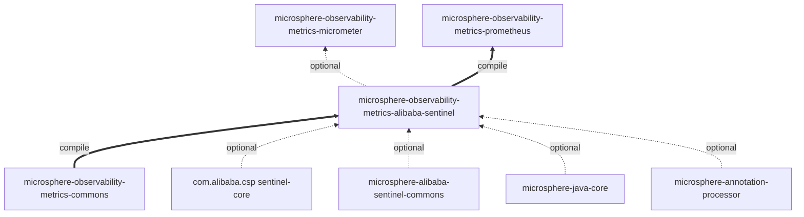
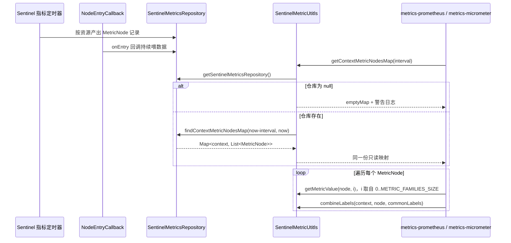
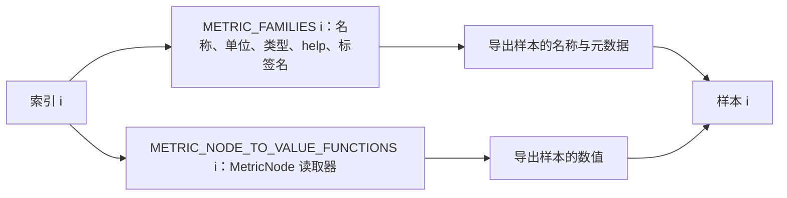

# metrics-alibaba-sentinel 开发者文档

[English version](../metrics-alibaba-sentinel.md) · [开发者文档索引](./README.md)

## 模块定位

`release` 分支 reactor 的第 5 个模块（紧跟 `metrics-commons`），打包方式 `jar`，父工程
`microsphere-observability-parent:${revision}`，版本 `${revision}` = `0.2.4-SNAPSHOT`。

它是 Sentinel 指标链路中的*定义层*：本模块拥有指标目录与抽取规则，而两条导出路径属于 `metrics-micrometer` 与
`metrics-prometheus`。正因如此，新增一个 Sentinel 指标只需要改动一处。



注意其中的不对称：`metrics-micrometer` 以 **optional** 作用域依赖本模块（Sentinel binder 是可选增强），而
`metrics-prometheus` 以 **compile** 作用域依赖本模块（它的采集器只有 Sentinel 这一族）。

## 架构设计

| 包 | 类型 | 职责 |
|:---|:---|:---|
| `io.microsphere.metrics.sentinel.constants` | `SentinelMetricsConstants` | 命名：指标名与标签名，全部位于 `PREFIX = "sentinel_"` 之下 |
| `io.microsphere.metrics.sentinel.util` | `SentinelMetricUtitls` | 目录与抽取：`MetricFamily` 列表、必需标签、`MetricNode` 读取方法、仓库时间窗查询 |

模块没有服务、没有 bean、没有生命周期，除常量目录之外也没有静态初始化逻辑。一切都可静态访问，因此两条导出路径可以在
任意线程中使用它。

## 依赖关系

| 依赖 | 作用域 | 用途 |
|:---|:---|:---|
| `microsphere-observability-metrics-commons` | compile | `MetricFamily`、`MetricType` |
| `com.alibaba.csp:sentinel-core` | optional | `MetricNode`、`Constants.SENTINEL_VERSION`、`ResourceTypeConstants`（测试） |
| `io.github.microsphere-projects:microsphere-alibaba-sentinel-commons` | optional | `SentinelMetricsRepository`、`SentinelUtils.getResourceTypeAsString`、`ProcessorSlotCallbackUtils` |
| `microsphere-java-core` | optional | `Utils`、`Logger`/`LoggerFactory`、`ListUtils`/`MapUtils`、`StringUtils` |
| `microsphere-annotation-processor` | optional | 构建期 |
| `junit-jupiter`、`microsphere-java-test`、`logback-classic` | test | 测试 |

两个 Sentinel 相关依赖被声明为 optional 是一种结构性表达：本模块*关于* Sentinel，但不把 Sentinel 强加到 classpath 上。
唯一必须的兄弟模块是 compile 作用域的 `metrics-commons`。

## 源码分析

### `SentinelMetricsConstants.java`

`…/src/main/java/io/microsphere/metrics/sentinel/constants/SentinelMetricsConstants.java`

- `PREFIX`（第 33 行）被拼进其余所有常量（`ORIGIN_LABEL_NAME` 第 38 行…`TIMESTAMP_LABEL_NAME` 第 63 行；指标名第
  68-98 行），因此改动前缀就会重命名整个命名空间。
- 以持有 `String` 常量的 `interface` 形式声明——这是 Java 8 之前的“常量持有者”写法；实现或继承该接口的类会继承这些名称，
  尽管仓库中没有这样的用法。
- `ORIGIN_LABEL_NAME`（38）已定义但不在 `REQUIRED_LABEL_NAMES` 中；`TIMESTAMP_LABEL_NAME`（63）同样不属于目录，而是由
  `SentinelMultiCollector.toLabels(...)` 追加（`…/metrics-prometheus/…/SentinelMultiCollector.java:142`）。两者因此是
  *协议名*而非目录成员——使用方代码必须尊重这一区分。

### `SentinelMetricUtitls.java`

`…/src/main/java/io/microsphere/metrics/sentinel/util/SentinelMetricUtitls.java`

该类是 `abstract` 且构造器私有（第 224 行），并实现了项目的工具类标记接口 `io.microsphere.util.Utils`（第 64 行）。

- `REQUIRED_LABEL_NAME_TO_VALUE_FUNCTION_MAP`（第 68-73 行）——私有的静态
  `Map<String, BiFunction<String, MetricNode, String>>`，由 `MapUtils.of(...)` 构造，含 4 项。每个函数只用到两个入参之一：
  `resource` 读取 `MetricNode::getResource`；`context` 返回传入的上下文字符串；`resource_type` 通过
  `SentinelUtils.getResourceTypeAsString(...)` 转换 `metricNode.getClassification()`；`version` 无视节点，返回常量
  `SENTINEL_VERSION`。
- `REQUIRED_LABEL_NAMES`（第 78 行）就是该映射的 `keySet()`——是活动视图而非拷贝，这正是其遍历顺序等于四个取值函数声明
  顺序的原因。
- `METRIC_FAMILIES`（第 83-91 行）——7 个由 `metrics-commons` 构造器创建的 `MetricFamily`，全部 `GAUGE`，全部共享同一个
  `REQUIRED_LABEL_NAMES` 引用。只有索引 0 带单位（`millseconds`）。注意 help 文本：索引 6（`sentinel_exception_qps`）
  写的是 `"The Block QPS of the Sentinel Resource"`，与索引 5 重复。
- `METRIC_NODE_TO_VALUE_FUNCTIONS`（第 96-104 行）——7 个方法引用，按位置与 `METRIC_FAMILIES` 绑定。这一索引对齐是本模块
  的核心不变式，但没有体现在类型系统里；`REQUIRED_LABEL_NAMES_SIZE`（109）与 `METRIC_FAMILIES_SIZE`（114）的存在，使
  使用方无需自行推算长度。
- `getContextMetricNodesMap(long interval)`（第 154-165 行）——通过
  `SentinelMetricsRepository.getSentinelMetricsRepository()` 解析单例；为 `null` 时记录日志
  `"SentinelMetricsRepository is not ready, please check whether it is configured"` 并返回 `Collections.emptyMap()`。
  否则以 `endTimeMs = currentTimeMillis()`、`beginTimeMs = endTimeMs - interval` 调用
  `findContextMetricNodesMap(beginTimeMs, endTimeMs)`。
- `combineLabels(...)`（第 174-179 行）——按 `REQUIRED_LABEL_NAMES_SIZE + commonLabels.size()` 预分配固定容量的链表
  hash map，先插入 `commonLabels` 再插入必需标签。因此同名时**必需标签覆盖**公共标签，并且顺序被保留，供 Prometheus 的
  `Labels.of(keys, values)` 使用。
- `getRequiredLabels(...)`（第 188-195 行）——遍历取值映射并返回 `unmodifiableMap(...)`，调用方得到的是防御式只读快照。
- `getRequiredLabelValue(...)`（第 206-208 行）——`MAP.get(labelName).apply(...)`；javadoc 声明未知名称抛
  `NullPointerException`，测试也对此断言。
- `getMetricValue(MetricNode, int)`（第 219-222 行）——按位置取函数、应用、`doubleValue()`。声明的异常：
  `IndexOutOfBoundsException`、`NullPointerException`。

## 设计模式

| 模式 | 位置 | 动机 |
|:---|:---|:---|
| 工具类（禁止实例化） | `abstract class … implements Utils` + 私有构造器（第 64、224 行） | 任意线程无状态访问目录 |
| 常量对象 / 命名空间持有者 | `SentinelMetricsConstants` 接口 | 一个前缀、多个名称，避免三个字模块中的字面量 |
| 目录即数据 | `METRIC_FAMILIES`、`REQUIRED_LABEL_NAMES`、`METRIC_NODE_TO_VALUE_FUNCTIONS` | 导出路径遍历固定列表，而非按指标分支 |
| 按位置的策略（平行数组） | `METRIC_FAMILIES` ↔ `METRIC_NODE_TO_VALUE_FUNCTIONS` 索引对齐 | 让元数据与取值逻辑分离，又无需为每个指标建类 |
| 函数表 | `REQUIRED_LABEL_NAME_TO_VALUE_FUNCTION_MAP`（第 68-73 行） | 标签抽取是一次查表，而标签集合由该表派生，二者不会漂移 |
| 优雅降级 / 空对象 | 仓库缺失时返回 `Collections.emptyMap()`（第 158 行） | 抓取时刻表现为“没有指标”，而不是抛异常 |
| 只读视图 | `unmodifiableMap`（第 194 行）、`keySet()` 视图（第 78 行） | 暴露静态状态但不交出可变引用 |

## 关键流程



索引对齐不变式——采集器循环之所以正确全靠它：



一旦两个列表的顺序或长度不一致，数值就会被静默地挂到错误的指标名上，不会抛出任何异常。唯一的护栏是
`SentinelMetricUtitlsTest#testConstants`：它断言 `METRIC_FAMILIES_SIZE == 7`、
`METRIC_NODE_TO_VALUE_FUNCTIONS.size() == 7`，并逐个索引断言指标族名称。

## 构建与测试

```bash
./mvnw -pl microsphere-observability-metrics-alibaba-sentinel test
```

测试类（均位于 `src/test/java/io/microsphere/metrics/sentinel/`）：

| 测试 | 覆盖内容 |
|:---|:---|
| `util/SentinelMetricUtitlsTest` | 目录内容、`buildMetricName` 的单位后缀规则、标签抽取（含 `COMMON_WEB`）、`combineLabels` 的合并顺序、仓库未就绪时的空映射，以及已声明的 `NullPointerException` / `IndexOutOfBoundsException` 契约 |
| `constants/SentinelMetricsConstantsTest` | 常量取值 |

`SentinelMetricUtitlsTest#testGetContextMetricNodesMap` 是唯一需要 Sentinel 真实运行的测试：它发起
100 次 `SentinelTemplate.call(resource, () -> sleep(10))`，通过 `addEntryCallback(...)` 安装仓库，并轮询
`getContextMetricNodesMap(60000)` 直到非空，最后在 `finally` 中移除回调。无需外部服务、数据库或容器——Sentinel 在进程内
运行。

## 扩展点

- **新增 Sentinel 指标**：在 `SentinelMetricsConstants` 追加名称常量，在 `METRIC_FAMILIES` 追加 `MetricFamily`，并在
  `METRIC_NODE_TO_VALUE_FUNCTIONS` 的**同一索引**追加对应的 `MetricNode` 读取方法，然后更新
  `SentinelMetricUtitlsTest`。`SentinelMultiCollector` 与 `SentinelCollector` 都基于 `METRIC_FAMILIES_SIZE` 循环，因此
  无需修改即可识别新指标。
- **新增标签**：在 `REQUIRED_LABEL_NAME_TO_VALUE_FUNCTION_MAP` 增加一项即可，`REQUIRED_LABEL_NAMES` 作为其 `keySet()`
  自动跟随。
- **修改指标命名空间**：只需改 `PREFIX`；注意 `TIMESTAMP_LABEL_NAME`/`ORIGIN_LABEL_NAME` 在 Prometheus 模块中以常量
  引用，重命名会保持一致。
- **替换仓库**：`getContextMetricNodesMap` 在调用时才解析单例，因此可以在不改动本模块的情况下安装另一个
  `SentinelMetricsRepository`。

## 相关文档

- [English Developer Guide](../metrics-alibaba-sentinel.md)
- [用户文档 —— metrics-alibaba-sentinel](../../user-guide/current/zh/metrics-alibaba-sentinel.md)
- [开发者文档 —— 1.x / release-1.x 分支](../1.x/zh/metrics-alibaba-sentinel.md)
- [本分支开发者文档索引](./README.md)
