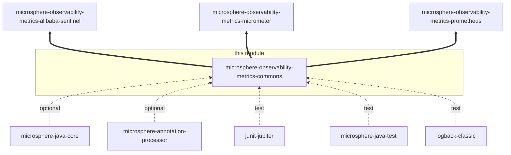
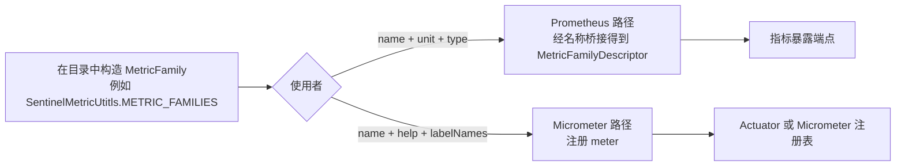

# metrics-commons 开发者文档

[English version](../metrics-commons.md) · [开发者文档索引](./README.md)

## 模块定位

`microsphere-observability-metrics-commons` 是 `release` 分支 reactor 中 12 个 `<module>` 里的第 4 个，紧跟在
`microsphere-observability-logging` 之后：

```xml
<modules>
    <module>microsphere-observability-parent</module>
    <module>microsphere-observability-dependencies</module>
    <module>microsphere-observability-logging</module>
    <module>microsphere-observability-metrics-commons</module>
    <module>microsphere-observability-metrics-alibaba-sentinel</module>
    <module>microsphere-observability-metrics-micrometer</module>
    <module>microsphere-observability-metrics-prometheus</module>
    <!-- …Spring 相关模块 -->
</modules>
```

| 属性 | 值 |
|:---|:---|
| 父工程 | `microsphere-observability-parent:${revision}` |
| 打包方式 | `jar` |
| reactor 版本 | `${revision}` = `0.2.4-SNAPSHOT` |
| 分析源码来源 | `origin/release` |
| 测试源码 | 无（本模块没有 `src/test/java`） |

它是依赖图中的叶子：不依赖本仓库的其它模块，而自身被三个模块以 `compile` 作用域依赖。

## 架构设计

本模块只有一个包 `io.microsphere.metrics.commons`，包含两个公开类型：

| 包 | 类型 | 职责 |
|:---|:---|:---|
| `io.microsphere.metrics.commons` | `MetricFamily`、`MetricType` | 以后端无关的方式描述指标族，使下游模块能共享同一份目录 |

刻意“没有行为”本身就是设计：本模块只拥有*名称、类型和标签结构*，而所有面向具体后端的转换都交给使用者。正因如此，
`metrics-alibaba-sentinel` 才能只发布一份 `METRIC_FAMILIES` 列表，同时供 Micrometer binder 路径和 Prometheus collector
路径读取。

## 依赖关系



粗边表示来自兄弟模块的 `compile` 方向依赖；本模块自身的编译期 classpath 是空的：

| 依赖 | 作用域 | 声明原因 |
|:---|:---|:---|
| `io.github.microsphere-projects:microsphere-annotation-processor` | optional | 全仓库共享的构建期注解/javadoc 处理 |
| `io.github.microsphere-projects:microsphere-java-core` | optional | 与兄弟模块保持一致而声明；本模块没有任何类型 import `io.microsphere.*` |
| `org.junit.jupiter:junit-jupiter` | test | 预留——目前无测试源码 |
| `io.github.microsphere-projects:microsphere-java-test` | test | 预留——目前无测试源码 |
| `ch.qos.logback:logback-classic` | test | 预留——目前无测试源码 |

由于 `microsphere-java-core` 是 `optional`，只使用这两个数据类型的消费者在运行时不会解析到任何额外构件。

## 源码分析

### `MetricType.java`

`microsphere-observability-metrics-commons/src/main/java/io/microsphere/metrics/commons/MetricType.java`

- 按声明顺序共 7 个常量：`COUNTER`（第 31 行）、`GAUGE`（33）、`HISTOGRAM`（35）、`SUMMARY`（37）、`INFO`（39）、
  `STATESET`（41）、`UNKNOWN`（43）。
- 类 javadoc（第 20-28 行）声明了它的对齐目标：Prometheus 指标类型文档、
  `io.prometheus.metrics.model.registry.MetricType` 与 `io.prometheus.client.Collector.Type`。没有字段、构造器和方法，
  因此该枚举不携带任何元数据，所有使用者都只能通过 `name()` 映射它。
- 映射点：`SentinelMultiCollector.buildMetricFamilyDescriptor(...)` 执行
  `MetricType.valueOf(metricFamily.getType().name())`
  （`microsphere-observability-metrics-prometheus/src/main/java/io/microsphere/metrics/prometheus/sentinel/SentinelMultiCollector.java:166`）。
  由于桥接基于名称，如果在本枚举新增一个 Prometheus 客户端没有同名常量的值，渲染调用就会抛出
  `IllegalArgumentException`；反之，只有目标枚举中存在 `UNKNOWN` 时它才是安全的。

### `MetricFamily.java`

`microsphere-observability-metrics-commons/src/main/java/io/microsphere/metrics/commons/MetricFamily.java`

- 5 个 `final` 字段（第 32-40 行）：`name`、`unit`、`type`、`help`、`labelNames`。
- 构造器（第 42 行）是**包级私有**的，因此在 `io.microsphere.metrics.commons` 之外无法实例化，`Builder.build()`
  （第 107 行）是唯一的产出路径。
- getter（第 50-68 行）是纯字段读取；`getLabelNames()` 返回调用方传入的 Set 而不拷贝，所以“不可变”只成立于字段本身，
  不成立于集合内容。
- `builder()`（第 70 行）返回一个新的 `Builder`；`Builder`（第 74-110 行）是这 5 个字段的可变镜像，提供链式 setter 且
  不做任何校验——`build()` 直接转调包级私有构造器。
- 没有 `equals`/`hashCode`/`toString`/`compareTo`。因此使用者不能依赖值相等语义；仓库里的目录都是 `static final`
  单例，正是为了保证标识稳定。

## 设计模式

| 模式 | 位置 | 在此处的作用 |
|:---|:---|:---|
| 建造者（Builder） | `MetricFamily.Builder`，经由 `MetricFamily.builder()`（第 70-110 行）进入 | 5 个可选字段且没有天然的参数顺序；链式写法让 `SentinelMetricUtitls` 能在一个表达式列表中声明 7 个指标族 |
| 不可变值对象（部分） | `MetricFamily` 字段（第 32-40 行）+ 包级私有构造器（第 42 行） | 使目录可以作为 `static final` 状态安全地暴露给 Micrometer 与 Prometheus 两条线程 |
| 具名类型 / 枚举目录 | `MetricType` | 把封闭的 Prometheus 类型集合收敛到一处，用基于名称的桥接取代每个后端一个适配器 |
| javadoc 对齐标记 | 类注释中对 `MetricFamilyDescriptor` 与 `Collector.MetricFamilySamples` 的 `@see` | 记录这个无行为模型的目标映射 |

## 关键流程

本模块自身没有运行时流程，它是所有指标导出流程的第一站：



两条路径必须在拼写上一致：Prometheus 路径会规范化名称（`sanitizeMetricName`）并追加单位，而 Micrometer 路径直接使用
书写时的名称。`SentinelMetricUtitls.buildMetricName(String, String)` 的存在，就是为了把这条拼接规则显式化、可测试化，
而不是藏在客户端行为里。

## 构建与测试

```bash
# 构建本模块及其 reactor 前置模块
./mvnw -pl microsphere-observability-metrics-commons -am package

# 运行其测试（当前没有）
./mvnw -pl microsphere-observability-metrics-commons test
```

本模块不需要外部服务，也没有 Spring profile 相关行为。`-P spring-cloud-2022 … spring-cloud-2025.1` 的选择由父工程继承，
但对本模块产物没有影响。

`MetricFamily` 的覆盖是间接的：`metrics-alibaba-sentinel` 中的 `SentinelMetricUtitlsTest` 断言了出厂指标族的每个字段，
包括“单位后缀”命名规则
（`microsphere-observability-metrics-alibaba-sentinel/src/test/java/io/microsphere/metrics/sentinel/util/SentinelMetricUtitlsTest.java:123`）。

## 扩展点

- 新增指标类型：在 `MetricType` 追加常量，并在依赖 Prometheus 导出前确认
  `io.prometheus.metrics.model.registry.MetricType` 中存在同名常量。
- 新增指标目录：在归属模块里构造 `MetricFamily`（如 `SentinelMetricUtitls.METRIC_FAMILIES`），并同时暴露
  `static final` 集合与 `…_SIZE` 常量——`SentinelMultiCollector` 正是按 `METRIC_FAMILIES_SIZE` 与
  `getMetricFamily(int)` 这一约定来遍历的。
- 不要在本模块加入行为（渲染、校验、注册表访问）：它被 Micrometer 与 Prometheus 两套栈共享，任何行为都会成为两者的
  新增耦合。

## 相关文档

- [English Developer Guide](../metrics-commons.md)
- [用户文档 —— metrics-commons](../../user-guide/current/zh/metrics-commons.md)
- [开发者文档 —— 1.x / release-1.x 分支](../1.x/zh/metrics-commons.md)
- [本分支开发者文档索引](./README.md)
