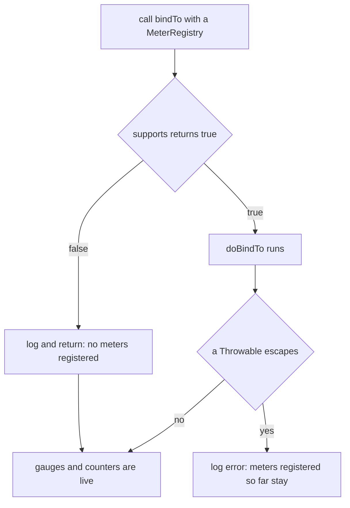

# Metrics Micrometer Binders — User Guide (0.1.x line)

[中文版](./zh/metrics-micrometer.md) · [User Guide index](../README.md)

## Overview

`microsphere-observability-metrics-micrometer` is a collection of custom Micrometer `MeterBinder`
implementations plus one P6Spy `JdbcEventListener`. It covers metrics that Micrometer's own JVM binders
do not expose: control-group (cGroup v1) memory, per-interface Linux network counters,
`com.sun.management` operating-system memory, arbitrary JMX MBean attributes, Alibaba Sentinel
per-resource cluster-node statistics, and SQL execution counters.

This document describes the `release-1.x` branch, i.e. the `0.1.x` version line. The module's sources,
resources and `pom.xml` are byte-identical to the `release` (0.2.x) branch — verified with
`git diff --stat origin/release origin/release-1.x -- microsphere-observability-metrics-micrometer`, which
reports no changes — so everything below is the same API; only the version line and the managed Micrometer /
Prometheus client versions differ.

The module is plain Java. It has no Spring dependency, ships no auto-configuration class, and registers nothing
by itself — you call `bindTo(MeterRegistry)`, or let
[`microsphere-observability-metrics-spring-boot`](../current/metrics-spring-boot.md) do it for you.

Capabilities:

- `AbstractMeterBinder` — a template-method base class that adds an `origin` tag, a `supports()` gate and exception
  swallowing around every binder.
- `MBeanMetrics` + `MBeanAttributeMeterBinder` — turn any MBean attribute of your choosing into Micrometer meters.
- `SystemMemoryMetrics` — five swap/physical/virtual memory gauges from the platform `OperatingSystemMXBean`.
- `CGroupMemoryMetrics` — container memory gauges read from `/sys/fs/cgroup/memory/`.
- `NetworkStatisticsMetrics` — rx/tx bytes, packets, errors and drops per interface, read from `/proc/net/dev` and
  refreshed on a schedule.
- `SentinelMetrics` — seven Sentinel `ClusterNode` gauges per resource, driven by `ClusterNodeAddedEvent`.
- `MicrometerJdbcEventListener` — SQL success/failure counters and a slow-SQL gauge, discovered by P6Spy through
  `META-INF/services`.
- `SystemConstants`, `SystemUtils`, `MicrometerUtils` — configuration keys, file readers and the shared async executor.

## Version and compatibility

| Fact | Value |
|---|---|
| Branch | `release-1.x` |
| Reactor `${revision}` | `0.1.4-SNAPSHOT` |
| Latest released version | `0.1.3` |
| Root pom parent | `microsphere-spring-cloud-parent:0.1.26` |
| `java.version` declared by the reactor | not declared |
| `microsphere-spring-cloud` BOM | `0.1.26` |
| `microsphere-alibaba-sentinel` BOM | `0.1.5` |
| `microsphere-i18n` BOM | `0.1.21` |
| `prometheus.version` (`io.prometheus:prometheus-metrics-bom`) | `1.8.0` |
| `opentelemetry-instrumentation-bom` | `2.31.1` |
| Micrometer (`io.micrometer:micrometer-core`) | not pinned here; version is managed by the upstream BOM chain |
| P6Spy (`p6spy:p6spy`) | not pinned here; version is managed by the upstream BOM chain |
| Sentinel (`com.alibaba.csp:sentinel-core`) | not pinned here; version comes from the `microsphere-alibaba-sentinel` BOM |
| Testing stack | JUnit Jupiter; the JUnit and Testcontainers BOMs of this line are `5.14.4` and `1.21.4` |

Differences that matter for this module between the two lines:

| Aspect | `0.1.x` (this document) | `0.2.x` (`current`) |
|---|---|---|
| Artifact version to declare | `0.1.3` (or `0.1.4-SNAPSHOT` in the reactor) | `0.2.3` / `0.2.4-SNAPSHOT` |
| Java version declared by the reactor | none | `17` |
| Managed Prometheus client BOM | `prometheus-metrics-bom:1.8.0` | `prometheus-metrics-bom:1.9.0` |
| `microsphere-alibaba-sentinel` BOM | `0.1.5` | `0.2.5` |
| Source files of this module | identical | identical |

The Spring version is not pinned by this repository; it comes from `microsphere-spring-cloud-parent` profiles,
selected with `-P spring-cloud-hoxton` and friends. It builds against the selected profile; the default is bold:

| Profile | Spring Boot | Spring Cloud | Spring Cloud Alibaba |
|---|---|---|---|
| `spring-cloud-hoxton` | 2.3.12.RELEASE | Hoxton.SR12 | 2.2.10 |
| `spring-cloud-2020` | 2.4.13 | 2020.0.5 | 2021.1 |
| **`spring-cloud-2021` (default)** | **2.6.15** | **2021.0.9** | **2021.0.6.1** |

The repository README states that the 0.1.x line targets Spring Cloud Hoxton–2021.0.x.

## Installation

Declare the module and every optional dependency you actually use. Micrometer, Sentinel, P6Spy and
`microsphere-java-core` are all `<optional>` in this module's pom, so they are **not** pulled in transitively.

```xml
<dependencyManagement>
    <dependencies>
        <dependency>
            <groupId>io.github.microsphere-projects</groupId>
            <artifactId>microsphere-observability-dependencies</artifactId>
            <version>0.1.3</version>
            <type>pom</type>
            <scope>import</scope>
        </dependency>
    </dependencies>
</dependencyManagement>

<dependencies>
    <dependency>
        <groupId>io.github.microsphere-projects</groupId>
        <artifactId>microsphere-observability-metrics-micrometer</artifactId>
    </dependency>

    <!-- mandatory in practice: MeterRegistry, MeterBinder, Gauge, Counter -->
    <dependency>
        <groupId>io.micrometer</groupId>
        <artifactId>micrometer-core</artifactId>
    </dependency>

    <!-- mandatory in practice: io.microsphere.util / management / io / logging APIs -->
    <dependency>
        <groupId>io.github.microsphere-projects</groupId>
        <artifactId>microsphere-java-core</artifactId>
    </dependency>

    <!-- only for MicrometerJdbcEventListener -->
    <dependency>
        <groupId>p6spy</groupId>
        <artifactId>p6spy</artifactId>
    </dependency>
</dependencies>
```

`microsphere-observability-dependencies` manages
`io.github.microsphere-projects:microsphere-observability-metrics-micrometer:${revision}` on this branch, so the
version may be omitted after the import. Add `microsphere-observability-metrics-alibaba-sentinel`,
`microsphere-alibaba-sentinel-commons`, `sentinel-core` and `sentinel-transport-simple-http` only if you bind
`SentinelMetrics`.

## Quick start

```java
MeterRegistry registry = new SimpleMeterRegistry();

// OS memory gauges: system.memory.physical.total and friends
new SystemMemoryMetrics().bindTo(registry);

// cGroup memory gauges: reads /sys/fs/cgroup/memory/** by default
new CGroupMemoryMetrics().bindTo(registry);

// network gauges per interface: reads /proc/net/dev every 60s by default
new NetworkStatisticsMetrics().bindTo(registry);
```

Every binder follows the same lifecycle:



## API reference

### `AbstractMeterBinder`

`io.microsphere.metrics.micrometer.instrument.binder.AbstractMeterBinder` — abstract class implementing
`io.micrometer.core.instrument.binder.MeterBinder`.

```java
public AbstractMeterBinder()
public AbstractMeterBinder(Iterable<Tag> commonTags)
protected String getOriginTagValue()          // simple class name of the concrete binder
protected Iterable<Tag> combine(String... tags)
public final void bindTo(MeterRegistry registry)
protected abstract boolean supports(MeterRegistry registry)
protected abstract void doBindTo(MeterRegistry registry) throws Throwable
```

- `ORIGIN_TAG_KEY` is the public constant `"origin"`; its value is `getSimpleName(getClass())` of the concrete binder
  (for example `SystemMemoryMetrics`), so subclasses change the tag value automatically.
- `commonTags` is the constructor tags concatenated with `origin=<simple name>`.
- `bindTo` is `final`: it checks `supports()`, logs `"Current Metrics is not supported"` and returns when false;
  otherwise it calls `doBindTo()` inside a `try/catch (Throwable)` that logs `"Bind To MeterRegistry[{}] failed"` and
  swallows the failure. Registration never throws, and a failing binder leaves whatever it had already registered.
- `logger` is a `io.microsphere.logging.Logger` created for the concrete class.
- Thread safety: `bindTo` is meant to be invoked once per registry; the base class adds no synchronisation.

### `MBeanAttributeMeterBinder` (JMX)

`io.microsphere.metrics.micrometer.instrument.binder.jmx.MBeanAttributeMeterBinder` — callback interface:

```java
void bindTo(ObjectName mBeanName, MBeanInfo mBeanInfo, MBeanAttributeInfo mBeanAttributeInfo,
            Object attributeValue, MeterRegistry registry) throws Throwable;
```

The metric name is decided here. The module ships **no** attribute-to-metric naming rule: your implementation inspects
`mBeanAttributeInfo.getName()` and registers whichever meters it wants; the attribute value arrives already unwrapped
as `Object`.

### `MBeanMetrics`

`io.microsphere.metrics.micrometer.instrument.binder.jmx.MBeanMetrics extends AbstractMeterBinder`.

```java
public MBeanMetrics(@Nonnull ObjectName objectNameToQuery, MBeanAttributeMeterBinder... attributeMeterBinders)
public MBeanMetrics(@Nullable MBeanServer mbeanserver, @Nonnull ObjectName objectNameToQuery,
                    MBeanAttributeMeterBinder... attributeMeterBinders)
public MBeanMetrics(@Nonnull MBeanServer mbeanserver, @Nonnull ObjectName objectNameToQuery, @Nullable QueryExp queryExp,
                    MBeanAttributeMeterBinder... attributeMeterBinders)
```

- The first constructor uses `ManagementFactory.getPlatformMBeanServer()`; the second allows a nullable server and no
  `QueryExp`; the third is the full form.
- `supports()` is `attributeMeterBinders.length > 0` — pass no binders and nothing is registered.
- `doBindTo()` calls `mBeanServer.queryNames(objectNameToQuery, queryExp)`; for every matched `ObjectName` it reads all
  attributes via `JmxUtils.getMBeanAttributes(mBeanServer, objectName)` and passes each
  (`mBeanName`, `MBeanInfo`, `MBeanAttributeInfo`, value) tuple to every binder.
- Which MBeans are bound is entirely your choice via the `ObjectName`; the module's test binds
  `java.util.logging:type=Logging` and reads its `LoggerNames` attribute.
- Snapshot semantics: attributes are sampled once at `bindTo()` time; there is no scheduled refresh.
- An empty `queryNames` result (MBean absent, wrong domain, `QueryExp` mismatch) registers nothing.
- `MBeanMetrics` does not apply `commonTags`/`combine()`, so `origin` appears only if your binder adds it.

### `SystemMemoryMetrics`

`io.microsphere.metrics.micrometer.instrument.binder.system.SystemMemoryMetrics extends AbstractMeterBinder`.

```java
public SystemMemoryMetrics()
public SystemMemoryMetrics(Iterable<Tag> tags)
public static boolean isSupported()
public static final boolean SUPPORTED
public static final String OPERATING_SYSTEM_MXBEAN_CLASS_NAME = "com.sun.management.OperatingSystemMXBean"
public static final String METRIC_PREFIX = SystemConstants.PREFIX; // "system."
```

`SUPPORTED` is resolved at class initialisation: the MXBean class name is resolved with the system class loader and
looked up through `ManagementFactory.getPlatformMXBean(...)` inside `ThrowableSupplier.execute(...)`, which yields
`false` on any throwable. `supports()` returns that cached flag.

| Metric | Type | Description | Base unit | Tags |
|---|---|---|---|---|
| `system.memory.swap.space.total` | Gauge | Total swap space size | `bytes` | `origin` |
| `system.memory.swap.space.free` | Gauge | Free swap space size | `bytes` | `origin` |
| `system.memory.committed.virtual` | Gauge | Committed virtual memory size | `bytes` | `origin` |
| `system.memory.physical.total` | Gauge | Total physical memory size | `bytes` | `origin` |
| `system.memory.physical.free` | Gauge | Free physical memory size | `bytes` | `origin` |

Suppliers are `getTotalSwapSpaceSize`, `getFreeSwapSpaceSize`, `getCommittedVirtualMemorySize`,
`getTotalPhysicalMemorySize` and `getFreePhysicalMemorySize` on `com.sun.management.OperatingSystemMXBean`, fetched via
`JmxUtils.getOperatingSystemMXBean()`. Nothing registers when the JVM does not expose that platform MXBean; the gate is
the MXBean lookup, not the operating-system name.

### `CGroupMemoryMetrics`

`io.microsphere.metrics.micrometer.instrument.binder.system.CGroupMemoryMetrics extends AbstractMeterBinder`.

```java
public CGroupMemoryMetrics()                                       // uses SystemUtils.getCGroupDirectoryPath()
public CGroupMemoryMetrics(Path cgroupDirectoryPath)
public CGroupMemoryMetrics(Path cgroupDirectoryPath, Iterable<Tag> tags)
public static final String METRIC_PREFIX = SystemConstants.CGROUP_PREFIX; // "system.cgroup."
```

`"memory"` is appended to the resolved directory, so the default scan directory is `/sys/fs/cgroup/memory/`, and
`memory.stat` is resolved inside it. `supports()` performs `Files.exists(memoryDirectoryPath)` and logs
`"The CGroup memory directory[path: '{}'] does not exist!"` when it is absent — on Windows, macOS, or Linux without the
cGroup v1 memory controller nothing is registered.

| Metric | Type | Source | Base unit | Tags |
|---|---|---|---|---|
| `system.cgroup.memory.usage_in_bytes` | Gauge | file `memory.usage_in_bytes`, first line | `bytes` | `origin` |
| `system.cgroup.memory.max_usage_in_bytes` | Gauge | file `memory.max_usage_in_bytes` | `bytes` | `origin` |
| `system.cgroup.memory.memsw.usage_in_bytes` | Gauge | file `memory.memsw.usage_in_bytes` | `bytes` | `origin` |
| `system.cgroup.memory.memsw.max_usage_in_bytes` | Gauge | file `memory.memsw.max_usage_in_bytes` | `bytes` | `origin` |
| `system.cgroup.memory.limit_in_bytes` | Gauge | file `memory.limit_in_bytes` | `bytes` | `origin` |
| `system.cgroup.memory.stat.<statistic>` | Gauge | key/value pair of `memory.stat` | `bytes` | `origin` |

`memory.stat` is parsed once at bind time by splitting on the first space, and gauges are registered for eleven
statistics: `cache`, `rss`, `mapped_file`, `swap`, `active_anon`, `inactive_anon`, `active_file`, `inactive_file`,
`unevictable`, `hierarchical_memory_limit`, `hierarchical_memsw_limit`. A non-numeric value is skipped with
`"memory.stat Statistics : {} is not numeric"`; a statistic missing from the file registers nothing; lines without a
space are ignored.

The five file-backed gauges re-read their file on every collection; the `memory.stat.*` gauges freeze the value that
was present at bind time.

### `NetworkStatisticsMetrics`

`io.microsphere.metrics.micrometer.instrument.binder.system.NetworkStatisticsMetrics extends AbstractMeterBinder`.

```java
public NetworkStatisticsMetrics()  // get(getNetworkStatsFilePath()), getMetricsCollectionInterval()
public NetworkStatisticsMetrics(Path statsFilePath, long interval)
public NetworkStatisticsMetrics(Path statsFilePath, long interval, @Nullable ScheduledExecutorService scheduledExecutorService)
public NetworkStatisticsMetrics(Path statsFilePath, long interval, @Nullable ScheduledExecutorService scheduledExecutorService,
                                @Nullable Iterable<Tag> tags)
public static final String METRIC_PREFIX = SystemConstants.NETWORK_PREFIX; // "system.network."
```

- `supports()` is `Files.exists(statsFilePath)`; `/proc/net/dev` does not exist on Windows or macOS, so those platforms
  register nothing (only the generic "not supported" info line from `bindTo`).
- `doBindTo()` parses the file once immediately, then schedules `bindStats` at a fixed rate of `interval` milliseconds
  on the provided executor, defaulting to the shared `MicrometerUtils.getScheduledExecutor()`.
- The two header lines are skipped; every remaining `name: numbers` line is decoded positionally: tokens 0-3 are
  receive bytes/packets/errors/drops, tokens 8-11 are transmit bytes/packets/errors/drops. Unparsable lines log
  `"The Stats can't be parsed by the line {} : {}"`.
- Each device contributes one extra tag pair `interface=<device name>` on top of `origin` and constructor tags.
- A device registers its eight gauges once (`computeIfAbsent`); later reads only update the backing `Stats` instance
  inside `synchronized (this)`.

| Metric | Type | Description | Base unit | Tags |
|---|---|---|---|---|
| `system.network.receive.bytes` | Gauge | Number of good received bytes | `bytes` | `origin`, `interface` |
| `system.network.receive.packets` | Gauge (strong reference) | Number of good packets received by the interface | — | `origin`, `interface` |
| `system.network.receive.errors` | Gauge (strong reference) | Total number of bad packets received on this network device | — | `origin`, `interface` |
| `system.network.receive.drop` | Gauge (strong reference) | Number of packets received but not processed | — | `origin`, `interface` |
| `system.network.transmit.bytes` | Gauge | Number of good transmitted bytes | `bytes` | `origin`, `interface` |
| `system.network.transmit.packets` | Gauge (strong reference) | Number of packets successfully transmitted | — | `origin`, `interface` |
| `system.network.transmit.errors` | Gauge (strong reference) | Total number of transmit problems | — | `origin`, `interface` |
| `system.network.transmit.drop` | Gauge (strong reference) | Number of packets dropped on their way to transmission | — | `origin`, `interface` |

### `SentinelMetrics`

`io.microsphere.metrics.micrometer.instrument.binder.sentinel.SentinelMetrics extends AbstractMeterBinder
implements ClusterNodeAddedEventListener`.

```java
public SentinelMetrics()
public SentinelMetrics(Iterable<Tag> tags)
public static final String RESOURCE_TAG_KEY = "sentinel_resource";
public static final String CONTEXT_TAG_KEY  = "sentinel_context";
public static final String TYPE_TAG_KEY     = "sentinel_resource_type";
public static final String VERSION_TAG_KEY  = "sentinel_version";
public void onEvent(ClusterNodeAddedEvent event)
```

- The constructor adds `sentinel_version=<com.alibaba.csp.sentinel.Constants.SENTINEL_VERSION>` to the common tags, so
  every metric also carries `origin=SentinelMetrics`.
- `supports()` requires `SentinelNodeEventPublisher.getSentinelNodeEventPublisher() != null`. The publisher exists only
  after Sentinel's entry-callback chain installed it — in the module's test through
  `ProcessorSlotCallbackUtils.addEntryCallback(new SentinelNodeEventPublisher())`. Without it `bindTo()` registers
  nothing and the package-private `registry` field stays `null`.
- `doBindTo()` stores the registry and subscribes `this` to the publisher; meters appear lazily, one set per
  `ClusterNodeAddedEvent`.

| Metric | Type | Supplier | Base unit | Tags |
|---|---|---|---|---|
| `sentinel_rt` | TimeGauge | `ClusterNode::avgRt`, time unit `MILLISECONDS` | derived by Micrometer from the time unit | as below |
| `sentinel_concurrency` | Gauge | `ClusterNode::totalRequest` | — | same |
| `sentinel_success_qps` | Gauge | `ClusterNode::successQps` | — | same |
| `sentinel_pass_qps` | Gauge | `ClusterNode::passQps` | — | same |
| `sentinel_occupied_pass_qps` | Gauge | `ClusterNode::occupiedPassQps` | — | same |
| `sentinel_block_qps` | Gauge | `ClusterNode::blockQps` | — | same |
| `sentinel_exception_qps` | Gauge | `ClusterNode::exceptionQps` | — | same |

Tag set on each meter: `origin=SentinelMetrics`, `sentinel_version`, `sentinel_resource=<resource name>`,
`sentinel_context=<context name>`, `sentinel_resource_type=<SentinelUtils.getResourceTypeAsString(...)>`. Name and label
constants come from `SentinelMetricsConstants` in `microsphere-observability-metrics-alibaba-sentinel`.

### `SystemConstants`

`io.microsphere.metrics.micrometer.instrument.binder.system.constants.SystemConstants` — public interface of constants.

| Constant | Value |
|---|---|
| `PREFIX` | `system.` |
| `CGROUP_PREFIX` | `system.cgroup.` |
| `CGROUP_DIRECTORY_PATH_PROPERTY_NAME` | `system.cgroup.dir` |
| `DEFAULT_CGROUP_DIRECTORY_PATH_PROPERTY_VALUE` | `/sys/fs/cgroup/` |
| `NETWORK_PREFIX` | `system.network.` |
| `NETWORK_STATS_FILE_PATH_PROPERTY_NAME` | `system.network.stats.file` |
| `DEFAULT_NETWORK_STATS_FILE_PATH` | `/proc/net/dev` |
| `METRICS_COLLECTION_INTERVAL_PROPERTY_NAME` | `system.metrics.collection.interval` |
| `DEFAULT_METRICS_COLLECTION_INTERVAL_PROPERTY_VALUE` | `60000` |

### `SystemUtils`

`io.microsphere.metrics.micrometer.instrument.binder.system.util.SystemUtils` — abstract class, private constructor.

| Method | Behaviour |
|---|---|
| `getCGroupDirectoryPath()` | `System.getProperty("system.cgroup.dir", "/sys/fs/cgroup/")`, non-null |
| `getNetworkStatsFilePath()` | `System.getProperty("system.network.stats.file", "/proc/net/dev")`, non-null |
| `getMetricsCollectionInterval()` | `Long.parseLong` of `system.metrics.collection.interval`, default `60000`; a non-numeric override throws |
| `readLines(Path)` | `IOUtils.readLines(Files.newInputStream(path))`; on `IOException` logs `"The file[path : '{}'] can't be read"` and returns `StringUtils.EMPTY_STRING_ARRAY` |

### `MicrometerUtils`

`io.microsphere.metrics.micrometer.util.MicrometerUtils extends BaseUtils` — abstract class, private constructor.

| Member | Value / behaviour |
|---|---|
| `MICROETER_SCHEDULED_EXECUTOR_SIZE_PROPERTY_NAME` | `microsphere.metrics.micrometer.scheduled-executor.core-size` |
| `DEFAULT_SCHEDULED_EXECUTOR_SIZE_PROPERTY_VALUE` / `DEFAULT_SCHEDULED_EXECUTOR_SIZE` | `"1"` / `1` |
| `SCHEDULED_EXECUTOR_SIZE` | `Integer.getInteger(name, 1)` — read once when the class loads |
| `async(Runnable)` | submits to the shared scheduled pool; `null` tasks are ignored |
| `getScheduledExecutor()` | the shared `ScheduledExecutorService`, threads named with the `Micrometer-Async-` prefix, registered via `shutdownOnExit` |

### `MicrometerJdbcEventListener` and the P6Spy service file

`io.microsphere.metrics.micrometer.instrument.binder.jdbc.p6spy.MicrometerJdbcEventListener extends
com.p6spy.engine.logging.LoggingEventListener`.

```java
public MicrometerJdbcEventListener(MeterRegistry registry)
public MicrometerJdbcEventListener()                 // registry stays null until setRegistry is called
public static void setRegistry(MeterRegistry registry)
public long getSlowSQLThresholdNanos()
public void setSlowSQLThresholdNanos(long slowSQLThresholdNanos)
String resolveStatementType(String sql)              // package-private, used by the test
void addMetrics(String sql, long timeElapsedNanos, int batchCounts, @Nullable SQLException e)
```

Events hooked (all P6Spy callbacks):

- `onAfterAnyExecute(StatementInformation, long timeElapsedNanos, SQLException)` — single-statement execution, batch
  count recorded as `0`.
- `onAfterExecuteBatch(StatementInformation, long timeElapsedNanos, int[] updateCounts, SQLException)` — batch
  execution, batch count recorded as `updateCounts.length`.
- `logElapsed(Loggable, long, Category, SQLException)` — overridden to forward the classic P6Spy
  `P6LogQuery.logElapsed(...)` call asynchronously instead of logging directly.

Every callback goes through `execute(Runnable)`, which returns immediately if the static `registry` is `null` and
otherwise hands the work to `MicrometerUtils.async(...)`, so metric recording never blocks the JDBC thread.

| Metric | Type | Tags | Registered when |
|---|---|---|---|
| `microsphere.jdbc.sql.success.count` | Counter | `type`, `batches` | the SQL's first token resolves to a statement type (also on failure) |
| `microsphere.jdbc.sql.failure.count` | Counter | `type`, `batches` | the same execution also reported a `SQLException` |
| `microsphere.jdbc.slow-sql.time` | Gauge (`() -> timeElapsedNanos`) | `sql`, `type`, `batches` | `timeElapsedNanos` exceeds `slowSQLThresholdNanos` |

`resolveStatementType` upper-cases the substring before the first whitespace (`SELECT`, `INSERT`, `UPDATE`, `DELETE`) and
returns `null` when the trimmed SQL has no whitespace after position 0, so a bare `HELP` produces no metrics.

The prefix constant `PREFIX` is `microsphere.jdbc.`. The threshold is read per listener instance from the system
property `microsphere.jdbc.slow-sql.time.threshold` (seconds, default `"1"`) via `Long.getLong`, converted with
`TimeUnit.SECONDS.toNanos`; `DEFAULT_SLOW_SQL_TIME_THRESHOLD` is `1_000_000_000` nanos.

Discovery: `src/main/resources/META-INF/services/com.p6spy.engine.event.JdbcEventListener` contains exactly one line,

```
io.microsphere.metrics.micrometer.instrument.binder.jdbc.p6spy.MicrometerJdbcEventListener
```

P6Spy therefore instantiates the listener from its compound-listener service loader, which calls the **no-arg**
constructor. Enabling it takes three things: P6Spy on the classpath, a `jdbc:p6spy:` URL (or `P6SpyDriver`), and a
registry handed to the listener, for example `MicrometerJdbcEventListener.setRegistry(myRegistry)`. The test datasource
`src/test/resources/META-INF/druid/h2.properties` shows the first two:

```properties
druid.url=jdbc:p6spy:h2:mem:test_db;DB_CLOSE_DELAY=-1
druid.driverClassName=com.p6spy.engine.spy.P6SpyDriver
```

No `spy.properties` file ships with this module; P6Spy defaults apply. Because `registry` is a `static volatile` field,
the last `setRegistry` call wins for all listener instances in that class loader.

## Configuration

| Key | Default | Read by | Effect |
|---|---|---|---|
| `system.cgroup.dir` | `/sys/fs/cgroup/` | `SystemUtils.getCGroupDirectoryPath()` via `System.getProperty` | base directory for the no-arg `CGroupMemoryMetrics`; `memory/` is appended |
| `system.network.stats.file` | `/proc/net/dev` | `SystemUtils.getNetworkStatsFilePath()` | file used by the no-arg `NetworkStatisticsMetrics` |
| `system.metrics.collection.interval` | `60000` (ms) | `SystemUtils.getMetricsCollectionInterval()` | refresh period of the network stats parser |
| `microsphere.jdbc.slow-sql.time.threshold` | `1` (seconds) | `Long.getLong(...)` per listener instance | slow-SQL threshold; `microsphere.jdbc.slow-sql.time` registers only above it |
| `microsphere.metrics.micrometer.scheduled-executor.core-size` | `1` | `Integer.getInteger(...)` at class load | pool size of the shared `Micrometer-Async-` executor |

All five are JVM system properties (`-Dkey=value`). In a Spring Boot 2.x application built from this line, the same
names also work through the Spring environment when the binders are created by the `metrics-spring-boot` module, which
injects them with placeholders such as `${system.network.stats.file:file:///proc/net/dev}`.

## Code examples

### Base-class contract (`AbstractMeterBinderTest`)

```java
class AbstractMeterBinderTest extends AbstractMeterBinder {

    @Override
    protected boolean supports(MeterRegistry registry) {
        return true;
    }

    @Override
    protected void doBindTo(MeterRegistry registry) throws Throwable {
        throw new Throwable("For testing");
    }

    @Test
    void testBindTo() {
        MeterRegistry registry = new SimpleMeterRegistry();
        super.bindTo(registry);
    }
}
```

The point of the test is that `bindTo` must not propagate the `Throwable`; production binders reuse the same contract:
`supports()` guards, `doBindTo()` registers.

### Shared test fixture (`AbstractMetricsTest`)

```java
protected final MeterRegistry registry = createRegistry();   // new SimpleMeterRegistry()
protected final T metrics = createMetrics();                 // reflective no-arg instantiation of T

@BeforeEach
protected void bindTo() {
    metrics.bindTo(registry);
}
```

`createMetrics()` resolves the first generic type argument of `AbstractMetricsTest` with
`from(getClass()).as(AbstractMetricsTest.class).getGenericType(0).toClass()` and instantiates it through
`ConstructorUtils.newInstance(metricsType)`; a binder tested this way must keep a public no-arg constructor.

### cGroup memory (`CGroupMemoryMetricsTest`)

```java
@BeforeAll
static void prepare() throws Throwable {
    ClassLoader classLoader = getDefaultClassLoader();
    String testDir = get(classLoader.getResource("test-data/").toURI()).toAbsolutePath().toString();
    setProperty(CGROUP_DIRECTORY_PATH_PROPERTY_NAME, testDir);
}

@Test
void test() {
    assertFalse(registry.getMeters().isEmpty());
    assertMeterPresent("system.cgroup.memory.usage_in_bytes");
    assertMeterPresent("system.cgroup.memory.max_usage_in_bytes");
    assertMeterPresent("system.cgroup.memory.memsw.usage_in_bytes");
    assertMeterPresent("system.cgroup.memory.memsw.max_usage_in_bytes");
    assertMeterPresent("system.cgroup.memory.limit_in_bytes");
    assertMeterPresent("system.cgroup.memory.stat.cache");
    assertMeterPresent("system.cgroup.memory.stat.rss");
    assertMeterPresent("system.cgroup.memory.stat.hierarchical_memory_limit");
}

@Test
void testOnNotFound() {
    CGroupMemoryMetrics cGroupMemoryMetrics = new CGroupMemoryMetrics(get("not-found"));
    assertFalse(cGroupMemoryMetrics.supports(this.registry));
}
```

`test-data/memory/memory.limit_in_bytes` holds `6442450944` and `memory.usage_in_bytes` holds `517832704`; the sample
`memory.stat` intentionally contains `unevictable for_test` and omits `hierarchical_memsw_limit`, which is why those two
assertions stay commented out.

### Network statistics (`NetworkStatisticsMetricsTest`)

```java
@BeforeAll
static void prepare() throws Throwable {
    ClassLoader classLoader = NetworkStatisticsMetricsTest.class.getClassLoader();
    String testFile = get(classLoader.getResource("test-data/memory/network.stats").toURI()).toAbsolutePath().toString();
    setProperty(NETWORK_STATS_FILE_PATH_PROPERTY_NAME, testFile);
}

@Test
void test() throws Throwable {
    assertFalse(registry.getMeters().isEmpty());
    File statsFile = new File(getNetworkStatsFilePath());
    try (StandardFileWatchService fileWatchService = new StandardFileWatchService()) {
        CountDownLatch countDownLatch = new CountDownLatch(1);
        fileWatchService.watch(statsFile, event -> {
            assertFalse(registry.getMeters().isEmpty());
            countDownLatch.countDown();
        }, MODIFIED);
        fileWatchService.start();
        statsFile.setLastModified(currentTimeMillis());
        countDownLatch.await();
    }
}
```

The fixture rows `eth0`, `lo`, `docker0` and the three `veth*` devices each produce eight gauges tagged with
`interface`, for example `system.network.receive.bytes{interface="eth0"}`.

### JMX (`MBeanMetricsTest`)

```java
ObjectName objectNameToQuery = new ObjectName("java.util.logging:type=Logging");
registry = new SimpleMeterRegistry();
mBeanMetrics = new MBeanMetrics(objectNameToQuery, (mBeanName, mBeanInfo, mBeanAttributeInfo, attributeValue, registry) -> {
    if ("LoggerNames".equals(mBeanAttributeInfo.getName())) {
        String[] loggerNames = (String[]) attributeValue;
        registry.counter(metricName)          // metricName = "logger.names.count"
                .increment(loggerNames.length);
    }
});

mBeanMetrics.bindTo(registry);
long count = registry.getMeters().stream()
        .filter(meter -> meter.getId().getName().equals(metricName))
        .count();
assertEquals(1, count);
```

### Sentinel (`SentinelMetricsTest`)

```java
void init() {
    addEntryCallback(new SentinelNodeEventPublisher());
}

@Test
void testSupports() {
    assertFalse(this.sentinelMetrics.supports(this.registry));
    assertDoesNotThrow(this::init);
    assertTrue(this.sentinelMetrics.supports(this.registry));
}

@Test
void testDoBindTo() {
    assertDoesNotThrow(() -> this.sentinelMetrics.bindTo(this.registry));
    assertNull(this.sentinelMetrics.registry);          // publisher absent -> nothing bound
    assertDoesNotThrow(this::init);
    assertDoesNotThrow(() -> this.sentinelMetrics.bindTo(this.registry));
    assertNotNull(this.sentinelMetrics.registry);
}

@Test
void testOnEvent() {
    assertDoesNotThrow(this::init);
    SentinelTemplate sentinelTemplate = new SentinelTemplate();
    this.sentinelMetrics.bindTo(this.registry);
    for (int i = 0; i < 100; i++) {
        sentinelTemplate.execute("test-resource-" + (i + 1), () -> {});
    }
    assertEquals(700, this.registry.getMeters().size());   // 7 gauges x 100 resources
}
```

### P6Spy unit and integration (`MicrometerJdbcEventListenerTest`, `MicrometerJdbcEventListenerIntegrationTest`)

```java
MeterRegistry registry = new SimpleMeterRegistry();
listener = new MicrometerJdbcEventListener(registry);

assertEquals("SELECT", listener.resolveStatementType("SELECT * FROM users;"));
assertEquals("INSERT", listener.resolveStatementType("INSERT INTO users(id) VALUES (1);"));
assertEquals("UPDATE", listener.resolveStatementType("UPDATE users SET ..."));
assertEquals("DELETE", listener.resolveStatementType("DELETE FROM users"));

listener.addMetrics("SELECT * FROM users;", 1000000000, 0, null);
```

The integration test runs on top of the Druid/H2 harness (a `jdbc:p6spy:h2:mem:test_db;DB_CLOSE_DELAY=-1` datasource),
proves that the `META-INF/services` file installed the listener by pulling it out of P6Spy's static
`CompoundJdbcEventListener`, injects a registry statically, and lowers the threshold to 1 nanos so every statement
counts as slow:

```java
CompoundJdbcEventListener compoundJdbcEventListener =
        getStaticFieldValue(true, DefaultJdbcEventListenerFactory.class, "jdbcEventListener");
List<JdbcEventListener> eventListeners = compoundJdbcEventListener.getEventListeners();
this.micrometerJdbcEventListener = (MicrometerJdbcEventListener) eventListeners.get(eventListeners.size() - 1);
this.micrometerJdbcEventListener.setRegistry(new SimpleMeterRegistry());
this.micrometerJdbcEventListener.setSlowSQLThresholdNanos(1);
assertEquals(1L, this.micrometerJdbcEventListener.getSlowSQLThresholdNanos());
super.test();                                                       // execute the harness statements
this.micrometerJdbcEventListener.setSlowSQLThresholdNanos(DEFAULT_SLOW_SQL_TIME_THRESHOLD);
assertThrows(SQLException.class, () -> executeStatement(statement -> statement.executeUpdate("INSERT INTO users")));
assertDoesNotThrow(() -> executeStatement(statement -> statement.execute("HELP")));
```

### Utilities (`SystemUtilsTest`, `SystemConstantsTest`, `MicrometerUtilsTest`)

```java
assertSystemPropertyValue(CGROUP_DIRECTORY_PATH_PROPERTY_NAME, "test_path", SystemUtils::getCGroupDirectoryPath);
assertSame(DEFAULT_CGROUP_DIRECTORY_PATH_PROPERTY_VALUE, getCGroupDirectoryPath());
assertSame(DEFAULT_NETWORK_STATS_FILE_PATH, getNetworkStatsFilePath());
assertEquals(parseLong(DEFAULT_METRICS_COLLECTION_INTERVAL_PROPERTY_VALUE), getMetricsCollectionInterval());

String[] lines = readLines(get(getResource("test-data/memory/network.stats").toURI()));
assertEquals(11, lines.length);
assertSame(EMPTY_STRING_ARRAY, readLines(get(getResource("test-data/memory").toURI()))); // directory -> IOException

assertEquals("system.cgroup.dir", CGROUP_DIRECTORY_PATH_PROPERTY_NAME);
assertEquals("/proc/net/dev", DEFAULT_NETWORK_STATS_FILE_PATH);

async(() -> {});
async(null);                                  // ignored
assertNotNull(getScheduledExecutor());
```

## Metrics / log output reference

| Prefix | Binder | Meters per subject | Fixed tags |
|---|---|---|---|
| `system.memory.` | `SystemMemoryMetrics` | 5 gauges | `origin=SystemMemoryMetrics` |
| `system.cgroup.` | `CGroupMemoryMetrics` | 5 file gauges + up to 11 `memory.stat.` gauges | `origin=CGroupMemoryMetrics` |
| `system.network.` | `NetworkStatisticsMetrics` | 8 gauges per interface | `origin=NetworkStatisticsMetrics`, `interface` |
| `sentinel_` | `SentinelMetrics` | 7 gauges per resource/context | `origin=SentinelMetrics`, `sentinel_version`, `sentinel_resource`, `sentinel_context`, `sentinel_resource_type` |
| (caller-defined) | `MBeanMetrics` | whatever your `MBeanAttributeMeterBinder` registers | none unless you add them |
| `microsphere.jdbc.` | `MicrometerJdbcEventListener` | 2 counters + 1 conditional gauge | `type`, `batches` (plus `sql` on the slow-SQL gauge) |

Log lines produced by this module (through `io.microsphere.logging`, routed to the host application's SLF4J/Logback or
Log4j2): `Current Metrics is not supported` (info), `Bind To MeterRegistry[{}] failed` (error),
`The CGroup memory directory[path: '{}'] does not exist!` (warn), `memory.stat Statistics : {} is not numeric` (warn),
`The Stats can't be parsed by the line {} : {}` (warn), `The file[path : '{}'] can't be read` (error),
`The Stats has been updated : {}` (trace).

## Notes and limitations

| Optional dependency | Used by | What degrades when it is absent |
|---|---|---|
| `io.micrometer:micrometer-core` | every class of the module | the jar is unusable — `MeterBinder`, `MeterRegistry`, `Gauge`, `Counter`, `TimeGauge`, `Tags`, `BaseUnits` and `NamedThreadFactory` are referenced directly; loading any class throws `NoClassDefFoundError` |
| `io.micrometer:micrometer-registry-prometheus` | no source file of this module | nothing here; the pom keeps it optional for downstream Prometheus exporters |
| `io.github.microsphere-projects:microsphere-java-core` | `Logger`, `ClassUtils`, `ClassLoaderUtils`, `StringUtils`, `ObjectUtils`, `MapUtils`, `ListUtils`, `SymbolConstants`, `IOUtils`, `JmxUtils`, `MBeanAttribute`, `BaseUtils`, `ThrowableSupplier`, `ExecutorUtils`, `@Nonnull`/`@Nullable`/`@ConfigurationProperty` | every binder fails to initialise; `AbstractMeterBinder` cannot even build `commonTags` |
| `microsphere-observability-metrics-alibaba-sentinel` | `SentinelMetricsConstants` (metric and label names) | `SentinelMetrics` cannot load; the JDBC, JMX and system binders keep working |
| `io.github.microsphere-projects:microsphere-alibaba-sentinel-commons` | `SentinelNodeEventPublisher`, `ClusterNodeAddedEvent`, `ClusterNodeAddedEventListener`, `SentinelUtils.getResourceTypeAsString` | `SentinelMetrics` cannot load |
| `com.alibaba.csp:sentinel-core` | `ClusterNode`, `Constants.SENTINEL_VERSION`, `MetricTimerListener`, `ProcessorSlotEntryCallback` | `SentinelMetrics` cannot load; no `sentinel_*` metrics |
| `com.alibaba.csp:sentinel-transport-simple-http` | not referenced by any source file of this module | no direct effect; declared so Sentinel dashboard heartbeats exist for applications binding `SentinelMetrics` |
| `p6spy:p6spy` | `MicrometerJdbcEventListener` and the `META-INF/services` file | the listener and the service registration become inert; no `microsphere.jdbc.*` metrics |
| `io.github.microsphere-projects:microsphere-annotation-processor` | build time only | no runtime impact; `@ConfigurationProperty` on `SystemConstants`, `MicrometerUtils` and `MicrometerJdbcEventListener` is not turned into configuration metadata |
| `microsphere-observability-metrics-commons` | compile scope, yet no source file imports `io.microsphere.metrics.commons.*` | nothing at runtime; it exists for reactor ordering and model alignment |

Behaviour worth planning around on this line:

- `AbstractMeterBinder.bindTo` swallows `Throwable`, so a misconfigured binder shows up as "metrics missing" rather than
  a startup failure; look for the `Bind To MeterRegistry[...] failed` line.
- `CGroupMemoryMetrics` and `NetworkStatisticsMetrics` are Linux/cGroup-v1 specific; on Windows and macOS the `supports()`
  checks on `/sys/fs/cgroup/memory` and `/proc/net/dev` fail and no meters are registered.
- `SystemMemoryMetrics` is gated by the presence of `com.sun.management.OperatingSystemMXBean`, not by OS name; where the
  platform MXBean is unavailable, `SUPPORTED` is `false` and nothing is registered. Note that the binder calls the
  long-returning accessors `getTotalSwapSpaceSize` / `getFreeSwapSpaceSize` / `getTotalPhysicalMemorySize` /
  `getFreePhysicalMemorySize` / `getCommittedVirtualMemorySize`, which have existed on
  `com.sun.management.OperatingSystemMXBean` since well before JDK 17; the newer `getTotalMemorySize` /
  `getFreeMemorySize` accessors are not used.
- The `memory.stat.*` gauges are bind-time snapshots; the five file gauges are re-read at each collection. If a file
  disappears after binding, `SystemUtils.readLines` returns an empty array and the gauge supplier's `lines[0]` access
  throws during collection, not at bind time.
- `NetworkStatisticsMetrics` never unregisters vanished interfaces and keeps a strong reference to every `Stats` it has
  seen (`strongReference(true)` on six of the eight gauges).
- `SentinelMetrics` accumulates one meter set per resource and context; high-cardinality resource names grow the registry.
- `MicrometerJdbcEventListener` keeps the registry in a static field that is never cleared; the JVM shares one registry.
- `microsphere.jdbc.slow-sql.time` is tagged with the full SQL text — a cardinality hazard for non-parameterised SQL.
- A failing SQL increments both `microsphere.jdbc.sql.success.count` and `microsphere.jdbc.sql.failure.count`, because
  the success counter is registered before the `SQLException` check.
- JDBC metric recording runs on the shared `Micrometer-Async-` pool (default 1 thread,
  `microsphere.metrics.micrometer.scheduled-executor.core-size`), so statement ordering is not guaranteed.
- Javadoc in these classes carries `@since 1.0.0`, which does not match any published `1.0.0` artifact of this
  repository; the artifact version lines are `0.1.x` (this branch) and `0.2.x` (`release`).

## Related documents

- [Metrics Micrometer Binders — Developer Guide (0.1.x line)](../../developer-guide/1.x/metrics-micrometer.md)
- [Metrics Micrometer Binders — User Guide (0.2.x line)](../current/metrics-micrometer.md)
- [User Guide index](../README.md)
