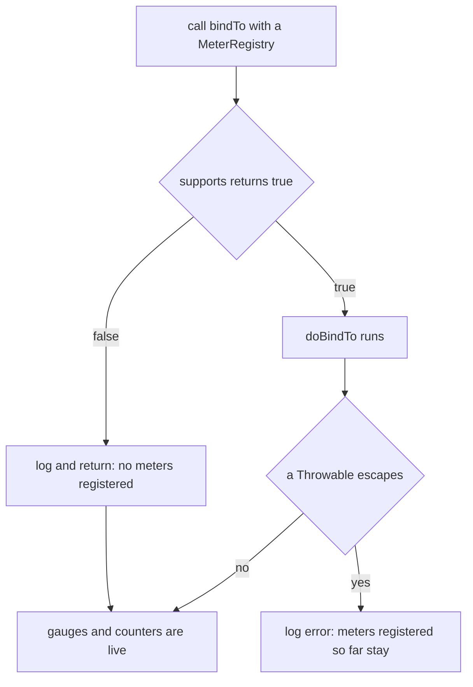

# Metrics Micrometer 指标绑定器 用户文档（0.1.x 版本线）

[English version](../metrics-micrometer.md) · [用户文档索引](../../README.md)

## 概述

`microsphere-observability-metrics-micrometer` 是一组自定义的 Micrometer `MeterBinder` 实现，外加一个 P6Spy 的
`JdbcEventListener`。它覆盖了 Micrometer 自带 JVM 绑定器没有暴露的指标：控制组（cGroup v1）内存、按网卡统计的 Linux
网络计数器、`com.sun.management` 操作系统内存、任意 JMX MBean 属性、Alibaba Sentinel 按资源维度的集群节点统计，
以及 SQL 执行计数器。

本文描述 `release-1.x` 分支，也就是 `0.1.x` 版本线。本模块的源码、资源与 `pom.xml` 与 `release`（0.2.x）分支逐字节相同
——用 `git diff --stat origin/release origin/release-1.x -- microsphere-observability-metrics-micrometer` 验证，输出为空
——因此下文 API 完全一致，差异只在版本线以及被管理的 Micrometer / Prometheus 客户端版本。

本模块是纯 Java 实现：不依赖 Spring，不提供自动配置类，也不会自行注册任何指标——需要你调用 `bindTo(MeterRegistry)`，
或者交给 [`microsphere-observability-metrics-spring-boot`](../current/metrics-spring-boot.md) 代为完成。

能力清单：

- `AbstractMeterBinder`——模板方法（Template Method）基类，为每个绑定器统一追加 `origin` 标签、`supports()` 门禁与异常吞掉逻辑。
- `MBeanMetrics` + `MBeanAttributeMeterBinder`——把你选定的任意 MBean 属性转换为 Micrometer 指标。
- `SystemMemoryMetrics`——基于平台 `OperatingSystemMXBean` 的五个交换/物理/虚拟内存仪表盘（Gauge）。
- `CGroupMemoryMetrics`——从 `/sys/fs/cgroup/memory/` 读取的容器内存仪表盘。
- `NetworkStatisticsMetrics`——按网卡统计的收发字节、报文、错误与丢弃数，来源于 `/proc/net/dev`，并按周期刷新。
- `SentinelMetrics`——由 `ClusterNodeAddedEvent` 驱动的七个 Sentinel `ClusterNode` 仪表盘（每个资源一套）。
- `MicrometerJdbcEventListener`——SQL 成功/失败计数器与慢 SQL 仪表盘，通过 `META-INF/services` 被 P6Spy 发现。
- `SystemConstants`、`SystemUtils`、`MicrometerUtils`——配置键、文件读取工具与共享异步线程池。

## 版本与兼容性

| 事实 | 取值 |
|---|---|
| 分支 | `release-1.x` |
| 反应堆 `${revision}` | `0.1.4-SNAPSHOT` |
| 最新已发布版本 | `0.1.3` |
| 根 pom 的 parent | `microsphere-spring-cloud-parent:0.1.26` |
| 反应堆声明的 `java.version` | 未声明 |
| `microsphere-spring-cloud` BOM | `0.1.26` |
| `microsphere-alibaba-sentinel` BOM | `0.1.5` |
| `microsphere-i18n` BOM | `0.1.21` |
| `prometheus.version`（`io.prometheus:prometheus-metrics-bom`） | `1.8.0` |
| `opentelemetry-instrumentation-bom` | `2.31.1` |
| Micrometer（`io.micrometer:micrometer-core`） | 本仓库不锁定，版本由上游 BOM 链管理 |
| P6Spy（`p6spy:p6spy`） | 本仓库不锁定，版本由上游 BOM 链管理 |
| Sentinel（`com.alibaba.csp:sentinel-core`） | 本仓库不锁定，版本来自 `microsphere-alibaba-sentinel` BOM |
| 测试栈 | JUnit Jupiter；该版本线的 JUnit 与 Testcontainers BOM 分别为 `5.14.4` 与 `1.21.4` |

两条版本线中对本模块有影响的差异：

| 方面 | `0.1.x`（本文） | `0.2.x`（`current`） |
|---|---|---|
| 需要声明的构件版本 | `0.1.3`（反应堆内为 `0.1.4-SNAPSHOT`） | `0.2.3` / `0.2.4-SNAPSHOT` |
| 反应堆声明的 Java 版本 | 无 | `17` |
| 被管理的 Prometheus 客户端 BOM | `prometheus-metrics-bom:1.8.0` | `prometheus-metrics-bom:1.9.0` |
| `microsphere-alibaba-sentinel` BOM | `0.1.5` | `0.2.5` |
| 本模块源码文件 | 完全相同 | 完全相同 |

Spring 版本并非由本仓库锁定，而是来自 `microsphere-spring-cloud-parent` 的 profile，通过 `-P spring-cloud-hoxton`
之类的参数选择。它按所选 profile 构建，加粗者为默认值：

| Profile | Spring Boot | Spring Cloud | Spring Cloud Alibaba |
|---|---|---|---|
| `spring-cloud-hoxton` | 2.3.12.RELEASE | Hoxton.SR12 | 2.2.10 |
| `spring-cloud-2020` | 2.4.13 | 2020.0.5 | 2021.1 |
| **`spring-cloud-2021`（默认）** | **2.6.15** | **2021.0.9** | **2021.0.6.1** |

仓库 README 的兼容性说明指出：0.1.x 版本线面向 Spring Cloud Hoxton–2021.0.x。

## 安装

请同时声明本模块以及你实际会用到的每一个可选依赖。在本模块的 pom 中，Micrometer、Sentinel、P6Spy 与
`microsphere-java-core` 全部是 `<optional>`，因此**不会**被传递引入。

```xml
<dependencyManagement>
    <dependencies>
        <dependency>
            <groupId>io.github.microsphere-projects</groupId>
            <artifactId>microsphere-observability-dependencies</artifactId>
            <version>0.1.3</version>
            <type>pom</type>
            <scope>import</scope>
        </dependency>
    </dependencies>
</dependencyManagement>

<dependencies>
    <dependency>
        <groupId>io.github.microsphere-projects</groupId>
        <artifactId>microsphere-observability-metrics-micrometer</artifactId>
    </dependency>

    <!-- 实际必需：MeterRegistry、MeterBinder、Gauge、Counter -->
    <dependency>
        <groupId>io.micrometer</groupId>
        <artifactId>micrometer-core</artifactId>
    </dependency>

    <!-- 实际必需：io.microsphere.util / management / io / logging 等 API -->
    <dependency>
        <groupId>io.github.microsphere-projects</groupId>
        <artifactId>microsphere-java-core</artifactId>
    </dependency>

    <!-- 仅 MicrometerJdbcEventListener 需要 -->
    <dependency>
        <groupId>p6spy</groupId>
        <artifactId>p6spy</artifactId>
    </dependency>
</dependencies>
```

在该分支上，`microsphere-observability-dependencies` 已经管理了
`io.github.microsphere-projects:microsphere-observability-metrics-micrometer:${revision}`，因此导入后版本号可以省略。
只有当你要绑定 `SentinelMetrics` 时，才需要添加 `microsphere-observability-metrics-alibaba-sentinel`、
`microsphere-alibaba-sentinel-commons`、`sentinel-core` 与 `sentinel-transport-simple-http`。

## 快速开始

```java
MeterRegistry registry = new SimpleMeterRegistry();

// 操作系统内存仪表盘：system.memory.physical.total 等
new SystemMemoryMetrics().bindTo(registry);

// cGroup 内存仪表盘：默认读取 /sys/fs/cgroup/memory/**
new CGroupMemoryMetrics().bindTo(registry);

// 按网卡的网络仪表盘：默认每 60 秒读取一次 /proc/net/dev
new NetworkStatisticsMetrics().bindTo(registry);
```

所有绑定器都遵循同一套生命周期：



## API 参考

### `AbstractMeterBinder`

`io.microsphere.metrics.micrometer.instrument.binder.AbstractMeterBinder`——实现了
`io.micrometer.core.instrument.binder.MeterBinder` 的抽象类。

```java
public AbstractMeterBinder()
public AbstractMeterBinder(Iterable<Tag> commonTags)
protected String getOriginTagValue()          // 具体绑定器自身的简单类名
protected Iterable<Tag> combine(String... tags)
public final void bindTo(MeterRegistry registry)
protected abstract boolean supports(MeterRegistry registry)
protected abstract void doBindTo(MeterRegistry registry) throws Throwable
```

- `ORIGIN_TAG_KEY` 是公有常量 `"origin"`；取值为具体绑定器的 `getSimpleName(getClass())`（例如
  `SystemMemoryMetrics`），因此子类会自动改变标签值。
- `commonTags` 等于构造入参标签再拼接 `origin=<简单类名>`。
- `bindTo` 是 `final` 的：先执行 `supports()`，为 `false` 时打印 `"Current Metrics is not supported"` 并返回；
  否则在 `try/catch (Throwable)` 中调用 `doBindTo()`，异常只打印 `"Bind To MeterRegistry[{}] failed"` 并吞掉。
  注册阶段永不抛异常，失败的绑定器会保留它已经注册的那部分指标。
- `logger` 是按具体类创建的 `io.microsphere.logging.Logger`。
- 线程安全：`bindTo` 设计为对同一个注册表调用一次，基类未添加任何同步。

### `MBeanAttributeMeterBinder`（JMX）

`io.microsphere.metrics.micrometer.instrument.binder.jmx.MBeanAttributeMeterBinder`——回调接口：

```java
void bindTo(ObjectName mBeanName, MBeanInfo mBeanInfo, MBeanAttributeInfo mBeanAttributeInfo,
            Object attributeValue, MeterRegistry registry) throws Throwable;
```

指标名称在这里决定。本模块**不提供**属性到指标名的命名规则：由你的实现检查 `mBeanAttributeInfo.getName()`，
并注册自己想要的任何指标；属性值已经以 `Object` 形式解开传给你。

### `MBeanMetrics`

`io.microsphere.metrics.micrometer.instrument.binder.jmx.MBeanMetrics extends AbstractMeterBinder`。

```java
public MBeanMetrics(@Nonnull ObjectName objectNameToQuery, MBeanAttributeMeterBinder... attributeMeterBinders)
public MBeanMetrics(@Nullable MBeanServer mbeanserver, @Nonnull ObjectName objectNameToQuery,
                    MBeanAttributeMeterBinder... attributeMeterBinders)
public MBeanMetrics(@Nonnull MBeanServer mbeanserver, @Nonnull ObjectName objectNameToQuery, @Nullable QueryExp queryExp,
                    MBeanAttributeMeterBinder... attributeMeterBinders)
```

- 第一个构造器使用 `ManagementFactory.getPlatformMBeanServer()`；第二个允许传入可为空的 server 且不带 `QueryExp`；
  第三个是完整形式。
- `supports()` 的判据是 `attributeMeterBinders.length > 0`——不传 binder 就什么都不注册。
- `doBindTo()` 调用 `mBeanServer.queryNames(objectNameToQuery, queryExp)`；对每个匹配到的 `ObjectName`，通过
  `JmxUtils.getMBeanAttributes(mBeanServer, objectName)` 读取全部属性，并把
  (`mBeanName`、`MBeanInfo`、`MBeanAttributeInfo`、value) 四元组交给每一个 binder。
- 绑定哪些 MBean 完全由你传入的 `ObjectName` 决定；模块自带的测试绑定 `java.util.logging:type=Logging`，
  读取其 `LoggerNames` 属性。
- 快照语义：属性只在 `bindTo()` 时采样一次，没有定时刷新。
- 若 `queryNames` 结果为空（MBean 不存在、domain 写错、`QueryExp` 不匹配），则不会注册任何指标。
- `MBeanMetrics` 没有应用 `commonTags`/`combine()`，因此只有你的 binder 主动添加时才会出现 `origin` 标签。

### `SystemMemoryMetrics`

`io.microsphere.metrics.micrometer.instrument.binder.system.SystemMemoryMetrics extends AbstractMeterBinder`。

```java
public SystemMemoryMetrics()
public SystemMemoryMetrics(Iterable<Tag> tags)
public static boolean isSupported()
public static final boolean SUPPORTED
public static final String OPERATING_SYSTEM_MXBEAN_CLASS_NAME = "com.sun.management.OperatingSystemMXBean"
public static final String METRIC_PREFIX = SystemConstants.PREFIX; // "system."
```

`SUPPORTED` 在类初始化阶段计算：用系统类加载器解析上述类名，并在 `ThrowableSupplier.execute(...)` 中执行
`ManagementFactory.getPlatformMXBean(...)` 查找，遇到任何 throwable 都返回 `false`。`supports()` 直接返回该缓存标志。

| 指标 | 类型 | 描述 | 基本单位 | 标签 |
|---|---|---|---|---|
| `system.memory.swap.space.total` | Gauge | Total swap space size | `bytes` | `origin` |
| `system.memory.swap.space.free` | Gauge | Free swap space size | `bytes` | `origin` |
| `system.memory.committed.virtual` | Gauge | Committed virtual memory size | `bytes` | `origin` |
| `system.memory.physical.total` | Gauge | Total physical memory size | `bytes` | `origin` |
| `system.memory.physical.free` | Gauge | Free physical memory size | `bytes` | `origin` |

数据来源是 `com.sun.management.OperatingSystemMXBean` 的 `getTotalSwapSpaceSize`、`getFreeSwapSpaceSize`、
`getCommittedVirtualMemorySize`、`getTotalPhysicalMemorySize`、`getFreePhysicalMemorySize`，实例通过
`JmxUtils.getOperatingSystemMXBean()` 获取。JVM 未暴露该平台 MXBean 时不会注册任何指标；门禁是 MXBean 查找，
而不是操作系统名称。

### `CGroupMemoryMetrics`

`io.microsphere.metrics.micrometer.instrument.binder.system.CGroupMemoryMetrics extends AbstractMeterBinder`。

```java
public CGroupMemoryMetrics()                                       // 使用 SystemUtils.getCGroupDirectoryPath()
public CGroupMemoryMetrics(Path cgroupDirectoryPath)
public CGroupMemoryMetrics(Path cgroupDirectoryPath, Iterable<Tag> tags)
public static final String METRIC_PREFIX = SystemConstants.CGROUP_PREFIX; // "system.cgroup."
```

解析出的目录后面会拼接 `"memory"`，所以默认扫描目录是 `/sys/fs/cgroup/memory/`，`memory.stat` 也在该目录内解析。
`supports()` 执行 `Files.exists(memoryDirectoryPath)`，缺失时打印
`"The CGroup memory directory[path: '{}'] does not exist!"`——在 Windows、macOS 以及没有 cGroup v1 内存控制器的
Linux 上什么都不会注册。

| 指标 | 类型 | 数据来源 | 基本单位 | 标签 |
|---|---|---|---|---|
| `system.cgroup.memory.usage_in_bytes` | Gauge | 文件 `memory.usage_in_bytes` 的第一行 | `bytes` | `origin` |
| `system.cgroup.memory.max_usage_in_bytes` | Gauge | 文件 `memory.max_usage_in_bytes` | `bytes` | `origin` |
| `system.cgroup.memory.memsw.usage_in_bytes` | Gauge | 文件 `memory.memsw.usage_in_bytes` | `bytes` | `origin` |
| `system.cgroup.memory.memsw.max_usage_in_bytes` | Gauge | 文件 `memory.memsw.max_usage_in_bytes` | `bytes` | `origin` |
| `system.cgroup.memory.limit_in_bytes` | Gauge | 文件 `memory.limit_in_bytes` | `bytes` | `origin` |
| `system.cgroup.memory.stat.<statistic>` | Gauge | `memory.stat` 中的键值对 | `bytes` | `origin` |

`memory.stat` 在绑定时按第一个空格切分解析一次，并为以下 11 个统计项注册仪表盘：`cache`、`rss`、`mapped_file`、`swap`、
`active_anon`、`inactive_anon`、`active_file`、`inactive_file`、`unevictable`、`hierarchical_memory_limit`、
`hierarchical_memsw_limit`。值不是数字的统计项被跳过并打印 `"memory.stat Statistics : {} is not numeric"`；文件中缺失的
统计项不会注册指标；不含空格的行被忽略。

五个基于文件的仪表盘在每次采集时重新读取文件；`memory.stat.*` 仪表盘则固化了绑定时刻的数值。

### `NetworkStatisticsMetrics`

`io.microsphere.metrics.micrometer.instrument.binder.system.NetworkStatisticsMetrics extends AbstractMeterBinder`。

```java
public NetworkStatisticsMetrics()  // get(getNetworkStatsFilePath()), getMetricsCollectionInterval()
public NetworkStatisticsMetrics(Path statsFilePath, long interval)
public NetworkStatisticsMetrics(Path statsFilePath, long interval, @Nullable ScheduledExecutorService scheduledExecutorService)
public NetworkStatisticsMetrics(Path statsFilePath, long interval, @Nullable ScheduledExecutorService scheduledExecutorService,
                                @Nullable Iterable<Tag> tags)
public static final String METRIC_PREFIX = SystemConstants.NETWORK_PREFIX; // "system.network."
```

- `supports()` 判据是 `Files.exists(statsFilePath)`；Windows 与 macOS 上不存在 `/proc/net/dev`，因此这些平台不会注册任何
  指标（只有 `bindTo` 那句通用的“不支持”info 日志）。
- `doBindTo()` 先立即解析一次文件，然后把 `bindStats` 以 `interval` 毫秒固定频率提交到传入的调度线程池；未传入时使用共享的
  `MicrometerUtils.getScheduledExecutor()`。
- 前两行表头被跳过；其余每行按 `name: numbers` 形式按位置解析：位置 0-3 是接收方向的字节/报文/错误/丢弃，位置 8-11 是
  发送方向的字节/报文/错误/丢弃。无法解析的行打印 `"The Stats can't be parsed by the line {} : {}"`。
- 每个设备额外贡献一对标签 `interface=<设备名>`，叠加在 `origin` 与构造器标签之上。
- 每个设备只注册一次这八个仪表盘（`computeIfAbsent`）；后续读取只在 `synchronized (this)` 保护下更新背后的 `Stats` 实例。

| 指标 | 类型 | 描述 | 基本单位 | 标签 |
|---|---|---|---|---|
| `system.network.receive.bytes` | Gauge | Number of good received bytes | `bytes` | `origin`、`interface` |
| `system.network.receive.packets` | Gauge（强引用） | Number of good packets received by the interface | — | `origin`、`interface` |
| `system.network.receive.errors` | Gauge（强引用） | Total number of bad packets received on this network device | — | `origin`、`interface` |
| `system.network.receive.drop` | Gauge（强引用） | Number of packets received but not processed | — | `origin`、`interface` |
| `system.network.transmit.bytes` | Gauge | Number of good transmitted bytes | `bytes` | `origin`、`interface` |
| `system.network.transmit.packets` | Gauge（强引用） | Number of packets successfully transmitted | — | `origin`、`interface` |
| `system.network.transmit.errors` | Gauge（强引用） | Total number of transmit problems | — | `origin`、`interface` |
| `system.network.transmit.drop` | Gauge（强引用） | Number of packets dropped on their way to transmission | — | `origin`、`interface` |

### `SentinelMetrics`

`io.microsphere.metrics.micrometer.instrument.binder.sentinel.SentinelMetrics extends AbstractMeterBinder
implements ClusterNodeAddedEventListener`。

```java
public SentinelMetrics()
public SentinelMetrics(Iterable<Tag> tags)
public static final String RESOURCE_TAG_KEY = "sentinel_resource";
public static final String CONTEXT_TAG_KEY  = "sentinel_context";
public static final String TYPE_TAG_KEY     = "sentinel_resource_type";
public static final String VERSION_TAG_KEY  = "sentinel_version";
public void onEvent(ClusterNodeAddedEvent event)
```

- 构造器把 `sentinel_version=<com.alibaba.csp.sentinel.Constants.SENTINEL_VERSION>` 加入公共标签，因此每个指标同时带有
  `origin=SentinelMetrics`。
- `supports()` 要求 `SentinelNodeEventPublisher.getSentinelNodeEventPublisher() != null`。只有当 Sentinel 入口回调链安装了
  该发布器之后它才存在——本模块测试中通过 `ProcessorSlotCallbackUtils.addEntryCallback(new SentinelNodeEventPublisher())`
  安装。缺少它时 `bindTo()` 不注册任何内容，包级私有字段 `registry` 保持 `null`。
- `doBindTo()` 保存 registry 并把 `this` 订阅到发布器；指标是延迟出现的，每个 `ClusterNodeAddedEvent` 产生一组。

| 指标 | 类型 | 数据来源 | 基本单位 | 标签 |
|---|---|---|---|---|
| `sentinel_rt` | TimeGauge | `ClusterNode::avgRt`，时间单位 `MILLISECONDS` | 由 Micrometer 依据时间单位推导 | 同下 |
| `sentinel_concurrency` | Gauge | `ClusterNode::totalRequest` | — | 同上 |
| `sentinel_success_qps` | Gauge | `ClusterNode::successQps` | — | 同上 |
| `sentinel_pass_qps` | Gauge | `ClusterNode::passQps` | — | 同上 |
| `sentinel_occupied_pass_qps` | Gauge | `ClusterNode::occupiedPassQps` | — | 同上 |
| `sentinel_block_qps` | Gauge | `ClusterNode::blockQps` | — | 同上 |
| `sentinel_exception_qps` | Gauge | `ClusterNode::exceptionQps` | — | 同上 |

每个指标上的标签集合：`origin=SentinelMetrics`、`sentinel_version`、`sentinel_resource=<资源名>`、
`sentinel_context=<上下文名>`、`sentinel_resource_type=<SentinelUtils.getResourceTypeAsString(...) 的返回值>`。
指标名与标签名常量来自 `microsphere-observability-metrics-alibaba-sentinel` 的 `SentinelMetricsConstants`。

### `SystemConstants`

`io.microsphere.metrics.micrometer.instrument.binder.system.constants.SystemConstants`——纯常量公有接口。

| 常量 | 取值 |
|---|---|
| `PREFIX` | `system.` |
| `CGROUP_PREFIX` | `system.cgroup.` |
| `CGROUP_DIRECTORY_PATH_PROPERTY_NAME` | `system.cgroup.dir` |
| `DEFAULT_CGROUP_DIRECTORY_PATH_PROPERTY_VALUE` | `/sys/fs/cgroup/` |
| `NETWORK_PREFIX` | `system.network.` |
| `NETWORK_STATS_FILE_PATH_PROPERTY_NAME` | `system.network.stats.file` |
| `DEFAULT_NETWORK_STATS_FILE_PATH` | `/proc/net/dev` |
| `METRICS_COLLECTION_INTERVAL_PROPERTY_NAME` | `system.metrics.collection.interval` |
| `DEFAULT_METRICS_COLLECTION_INTERVAL_PROPERTY_VALUE` | `60000` |

### `SystemUtils`

`io.microsphere.metrics.micrometer.instrument.binder.system.util.SystemUtils`——抽象类，私有构造器。

| 方法 | 行为 |
|---|---|
| `getCGroupDirectoryPath()` | `System.getProperty("system.cgroup.dir", "/sys/fs/cgroup/")`，非空 |
| `getNetworkStatsFilePath()` | `System.getProperty("system.network.stats.file", "/proc/net/dev")`，非空 |
| `getMetricsCollectionInterval()` | 对 `system.metrics.collection.interval` 执行 `Long.parseLong`，默认 `60000`；覆盖值非数字时抛异常 |
| `readLines(Path)` | `IOUtils.readLines(Files.newInputStream(path))`；发生 `IOException` 时打印 `"The file[path : '{}'] can't be read"` 并返回 `StringUtils.EMPTY_STRING_ARRAY` |

### `MicrometerUtils`

`io.microsphere.metrics.micrometer.util.MicrometerUtils extends BaseUtils`——抽象类，私有构造器。

| 成员 | 取值 / 行为 |
|---|---|
| `MICROETER_SCHEDULED_EXECUTOR_SIZE_PROPERTY_NAME` | `microsphere.metrics.micrometer.scheduled-executor.core-size` |
| `DEFAULT_SCHEDULED_EXECUTOR_SIZE_PROPERTY_VALUE` / `DEFAULT_SCHEDULED_EXECUTOR_SIZE` | `"1"` / `1` |
| `SCHEDULED_EXECUTOR_SIZE` | `Integer.getInteger(name, 1)`——类加载时读取一次 |
| `async(Runnable)` | 提交到共享调度线程池；`null` 任务被忽略 |
| `getScheduledExecutor()` | 共享的 `ScheduledExecutorService`，线程名以 `Micrometer-Async-` 为前缀，并通过 `shutdownOnExit` 在退出时关闭 |

### `MicrometerJdbcEventListener` 与 P6Spy 服务文件

`io.microsphere.metrics.micrometer.instrument.binder.jdbc.p6spy.MicrometerJdbcEventListener extends
com.p6spy.engine.logging.LoggingEventListener`。

```java
public MicrometerJdbcEventListener(MeterRegistry registry)
public MicrometerJdbcEventListener()                 // 调用 setRegistry 之前 registry 为 null
public static void setRegistry(MeterRegistry registry)
public long getSlowSQLThresholdNanos()
public void setSlowSQLThresholdNanos(long slowSQLThresholdNanos)
String resolveStatementType(String sql)              // 包级私有，测试使用
void addMetrics(String sql, long timeElapsedNanos, int batchCounts, @Nullable SQLException e)
```

被接管的事件（均为 P6Spy 回调）：

- `onAfterAnyExecute(StatementInformation, long timeElapsedNanos, SQLException)`——单条语句执行，批次数记为 `0`。
- `onAfterExecuteBatch(StatementInformation, long timeElapsedNanos, int[] updateCounts, SQLException)`——批量执行，
  批次数记为 `updateCounts.length`。
- `logElapsed(Loggable, long, Category, SQLException)`——被重写为异步转调 P6Spy 经典的 `P6LogQuery.logElapsed(...)`，
  而不再直接写日志。

每个回调都经由 `execute(Runnable)`：静态 `registry` 为 `null` 时立即返回，否则把记录动作交给 `MicrometerUtils.async(...)`，
因此指标记录不会阻塞 JDBC 线程。

| 指标 | 类型 | 标签 | 注册条件 |
|---|---|---|---|
| `microsphere.jdbc.sql.success.count` | Counter | `type`、`batches` | SQL 首个词能解析出语句类型时（失败的 SQL 同样累加） |
| `microsphere.jdbc.sql.failure.count` | Counter | `type`、`batches` | 同一次执行还报告了 `SQLException` |
| `microsphere.jdbc.slow-sql.time` | Gauge（`() -> timeElapsedNanos`） | `sql`、`type`、`batches` | `timeElapsedNanos` 超过 `slowSQLThresholdNanos` |

`resolveStatementType` 把第一个空白字符之前的子串转为大写（`SELECT`、`INSERT`、`UPDATE`、`DELETE`）；当去除首尾空格后的
SQL 在位置 0 之后没有空白字符时返回 `null`，因此单独一条 `HELP` 不会产生任何指标。

前缀常量 `PREFIX` 为 `microsphere.jdbc.`。慢 SQL 阈值按监听器实例从系统属性 `microsphere.jdbc.slow-sql.time.threshold`
（单位为秒，默认 `"1"`）通过 `Long.getLong` 读取，并用 `TimeUnit.SECONDS.toNanos` 换算；`DEFAULT_SLOW_SQL_TIME_THRESHOLD`
等于 `1_000_000_000` 纳秒。

发现机制：`src/main/resources/META-INF/services/com.p6spy.engine.event.JdbcEventListener` 只有一行内容，

```
io.microsphere.metrics.micrometer.instrument.binder.jdbc.p6spy.MicrometerJdbcEventListener
```

于是 P6Spy 通过其复合监听器服务加载器实例化本监听器——调用的是**无参**构造器。启用它需要三件事：类路径上有 P6Spy、
使用 `jdbc:p6spy:` 形式的 URL（或 `P6SpyDriver`）、把 registry 交给监听器，例如
`MicrometerJdbcEventListener.setRegistry(myRegistry)`。测试数据源
`src/test/resources/META-INF/druid/h2.properties` 展示了前两项：

```properties
druid.url=jdbc:p6spy:h2:mem:test_db;DB_CLOSE_DELAY=-1
druid.driverClassName=com.p6spy.engine.spy.P6SpyDriver
```

本模块不提供 `spy.properties`，使用 P6Spy 默认配置。由于 `registry` 是 `static volatile` 字段，在同一个类加载器内最后一次
`setRegistry` 调用对所有监听器实例生效。

## 配置

| 配置键 | 默认值 | 读取方 | 作用 |
|---|---|---|---|
| `system.cgroup.dir` | `/sys/fs/cgroup/` | `SystemUtils.getCGroupDirectoryPath()`（`System.getProperty`） | 无参 `CGroupMemoryMetrics` 的基础目录，代码会再拼接 `memory/` |
| `system.network.stats.file` | `/proc/net/dev` | `SystemUtils.getNetworkStatsFilePath()` | 无参 `NetworkStatisticsMetrics` 读取的文件 |
| `system.metrics.collection.interval` | `60000`（毫秒） | `SystemUtils.getMetricsCollectionInterval()` | 网络统计解析任务的刷新周期 |
| `microsphere.jdbc.slow-sql.time.threshold` | `1`（秒） | 每个监听器实例调用 `Long.getLong(...)` | 慢 SQL 阈值，超过它才注册 `microsphere.jdbc.slow-sql.time` |
| `microsphere.metrics.micrometer.scheduled-executor.core-size` | `1` | 类加载时 `Integer.getInteger(...)` | 共享 `Micrometer-Async-` 线程池大小 |

以上五项都是 JVM 系统属性（`-Dkey=value`）。在这一版本线上基于 Spring Boot 2.x 的应用中，如果绑定器由
`metrics-spring-boot` 模块创建，同名配置也能通过 Spring 环境生效，因为那个模块使用
`${system.network.stats.file:file:///proc/net/dev}` 这类占位符注入。

## 代码示例

### 基类契约（`AbstractMeterBinderTest`）

```java
class AbstractMeterBinderTest extends AbstractMeterBinder {

    @Override
    protected boolean supports(MeterRegistry registry) {
        return true;
    }

    @Override
    protected void doBindTo(MeterRegistry registry) throws Throwable {
        throw new Throwable("For testing");
    }

    @Test
    void testBindTo() {
        MeterRegistry registry = new SimpleMeterRegistry();
        super.bindTo(registry);
    }
}
```

该测试的意义在于 `bindTo` 不能把 `Throwable` 传播出去；生产代码复用同一套契约：`supports()` 负责门禁，`doBindTo()`
负责注册。

### 公共测试夹具（`AbstractMetricsTest`）

```java
protected final MeterRegistry registry = createRegistry();   // new SimpleMeterRegistry()
protected final T metrics = createMetrics();                 // 反射调用 T 的无参构造器

@BeforeEach
protected void bindTo() {
    metrics.bindTo(registry);
}
```

`createMetrics()` 通过 `from(getClass()).as(AbstractMetricsTest.class).getGenericType(0).toClass()` 解析
`AbstractMetricsTest` 的第一个泛型实参，再用 `ConstructorUtils.newInstance(metricsType)` 实例化；因此以这种方式被测试的
绑定器必须保留公有无参构造器。

### cGroup 内存（`CGroupMemoryMetricsTest`）

```java
@BeforeAll
static void prepare() throws Throwable {
    ClassLoader classLoader = getDefaultClassLoader();
    String testDir = get(classLoader.getResource("test-data/").toURI()).toAbsolutePath().toString();
    setProperty(CGROUP_DIRECTORY_PATH_PROPERTY_NAME, testDir);
}

@Test
void test() {
    assertFalse(registry.getMeters().isEmpty());
    assertMeterPresent("system.cgroup.memory.usage_in_bytes");
    assertMeterPresent("system.cgroup.memory.max_usage_in_bytes");
    assertMeterPresent("system.cgroup.memory.memsw.usage_in_bytes");
    assertMeterPresent("system.cgroup.memory.memsw.max_usage_in_bytes");
    assertMeterPresent("system.cgroup.memory.limit_in_bytes");
    assertMeterPresent("system.cgroup.memory.stat.cache");
    assertMeterPresent("system.cgroup.memory.stat.rss");
    assertMeterPresent("system.cgroup.memory.stat.hierarchical_memory_limit");
}

@Test
void testOnNotFound() {
    CGroupMemoryMetrics cGroupMemoryMetrics = new CGroupMemoryMetrics(get("not-found"));
    assertFalse(cGroupMemoryMetrics.supports(this.registry));
}
```

其中 `test-data/memory/memory.limit_in_bytes` 的内容是 `6442450944`，`memory.usage_in_bytes` 是 `517832704`；示例
`memory.stat` 故意写成 `unevictable for_test` 并缺少 `hierarchical_memsw_limit`，这正是测试里保留这两条注释的原因。

### 网络统计（`NetworkStatisticsMetricsTest`）

```java
@BeforeAll
static void prepare() throws Throwable {
    ClassLoader classLoader = NetworkStatisticsMetricsTest.class.getClassLoader();
    String testFile = get(classLoader.getResource("test-data/memory/network.stats").toURI()).toAbsolutePath().toString();
    setProperty(NETWORK_STATS_FILE_PATH_PROPERTY_NAME, testFile);
}

@Test
void test() throws Throwable {
    assertFalse(registry.getMeters().isEmpty());
    File statsFile = new File(getNetworkStatsFilePath());
    try (StandardFileWatchService fileWatchService = new StandardFileWatchService()) {
        CountDownLatch countDownLatch = new CountDownLatch(1);
        fileWatchService.watch(statsFile, event -> {
            assertFalse(registry.getMeters().isEmpty());
            countDownLatch.countDown();
        }, MODIFIED);
        fileWatchService.start();
        statsFile.setLastModified(currentTimeMillis());
        countDownLatch.await();
    }
}
```

夹具文件中的 `eth0`、`lo`、`docker0` 以及三个 `veth*` 设备各自产生八个带 `interface` 标签的仪表盘，例如
`system.network.receive.bytes{interface="eth0"}`。

### JMX（`MBeanMetricsTest`）

```java
ObjectName objectNameToQuery = new ObjectName("java.util.logging:type=Logging");
registry = new SimpleMeterRegistry();
mBeanMetrics = new MBeanMetrics(objectNameToQuery, (mBeanName, mBeanInfo, mBeanAttributeInfo, attributeValue, registry) -> {
    if ("LoggerNames".equals(mBeanAttributeInfo.getName())) {
        String[] loggerNames = (String[]) attributeValue;
        registry.counter(metricName)          // metricName = "logger.names.count"
                .increment(loggerNames.length);
    }
});

mBeanMetrics.bindTo(registry);
long count = registry.getMeters().stream()
        .filter(meter -> meter.getId().getName().equals(metricName))
        .count();
assertEquals(1, count);
```

### Sentinel（`SentinelMetricsTest`）

```java
void init() {
    addEntryCallback(new SentinelNodeEventPublisher());
}

@Test
void testSupports() {
    assertFalse(this.sentinelMetrics.supports(this.registry));
    assertDoesNotThrow(this::init);
    assertTrue(this.sentinelMetrics.supports(this.registry));
}

@Test
void testDoBindTo() {
    assertDoesNotThrow(() -> this.sentinelMetrics.bindTo(this.registry));
    assertNull(this.sentinelMetrics.registry);          // 没有发布器 -> 什么都没绑定
    assertDoesNotThrow(this::init);
    assertDoesNotThrow(() -> this.sentinelMetrics.bindTo(this.registry));
    assertNotNull(this.sentinelMetrics.registry);
}

@Test
void testOnEvent() {
    assertDoesNotThrow(this::init);
    SentinelTemplate sentinelTemplate = new SentinelTemplate();
    this.sentinelMetrics.bindTo(this.registry);
    for (int i = 0; i < 100; i++) {
        sentinelTemplate.execute("test-resource-" + (i + 1), () -> {});
    }
    assertEquals(700, this.registry.getMeters().size());   // 每个资源 7 个仪表盘 x 100 个资源
}
```

### P6Spy 单元测试与集成测试（`MicrometerJdbcEventListenerTest`、`MicrometerJdbcEventListenerIntegrationTest`）

```java
MeterRegistry registry = new SimpleMeterRegistry();
listener = new MicrometerJdbcEventListener(registry);

assertEquals("SELECT", listener.resolveStatementType("SELECT * FROM users;"));
assertEquals("INSERT", listener.resolveStatementType("INSERT INTO users(id) VALUES (1);"));
assertEquals("UPDATE", listener.resolveStatementType("UPDATE users SET ..."));
assertEquals("DELETE", listener.resolveStatementType("DELETE FROM users"));

listener.addMetrics("SELECT * FROM users;", 1000000000, 0, null);
```

集成测试基于 Druid/H2 测试基座（数据源为 `jdbc:p6spy:h2:mem:test_db;DB_CLOSE_DELAY=-1`），它从 P6Spy 的静态
`CompoundJdbcEventListener` 中取出监听器，从而证明 `META-INF/services` 文件确实把它装了进去；随后静态注入 registry，
并把阈值降到 1 纳秒，使每条语句都被视为“慢”：

```java
CompoundJdbcEventListener compoundJdbcEventListener =
        getStaticFieldValue(true, DefaultJdbcEventListenerFactory.class, "jdbcEventListener");
List<JdbcEventListener> eventListeners = compoundJdbcEventListener.getEventListeners();
this.micrometerJdbcEventListener = (MicrometerJdbcEventListener) eventListeners.get(eventListeners.size() - 1);
this.micrometerJdbcEventListener.setRegistry(new SimpleMeterRegistry());
this.micrometerJdbcEventListener.setSlowSQLThresholdNanos(1);
assertEquals(1L, this.micrometerJdbcEventListener.getSlowSQLThresholdNanos());
super.test();                                                       // 执行测试基座中的语句
this.micrometerJdbcEventListener.setSlowSQLThresholdNanos(DEFAULT_SLOW_SQL_TIME_THRESHOLD);
assertThrows(SQLException.class, () -> executeStatement(statement -> statement.executeUpdate("INSERT INTO users")));
assertDoesNotThrow(() -> executeStatement(statement -> statement.execute("HELP")));
```

### 工具类（`SystemUtilsTest`、`SystemConstantsTest`、`MicrometerUtilsTest`）

```java
assertSystemPropertyValue(CGROUP_DIRECTORY_PATH_PROPERTY_NAME, "test_path", SystemUtils::getCGroupDirectoryPath);
assertSame(DEFAULT_CGROUP_DIRECTORY_PATH_PROPERTY_VALUE, getCGroupDirectoryPath());
assertSame(DEFAULT_NETWORK_STATS_FILE_PATH, getNetworkStatsFilePath());
assertEquals(parseLong(DEFAULT_METRICS_COLLECTION_INTERVAL_PROPERTY_VALUE), getMetricsCollectionInterval());

String[] lines = readLines(get(getResource("test-data/memory/network.stats").toURI()));
assertEquals(11, lines.length);
assertSame(EMPTY_STRING_ARRAY, readLines(get(getResource("test-data/memory").toURI()))); // 目录 -> IOException

assertEquals("system.cgroup.dir", CGROUP_DIRECTORY_PATH_PROPERTY_NAME);
assertEquals("/proc/net/dev", DEFAULT_NETWORK_STATS_FILE_PATH);

async(() -> {});
async(null);                                  // 被忽略
assertNotNull(getScheduledExecutor());
```

## 指标 / 日志输出参考

| 前缀 | 绑定器 | 每个主题的指标数 | 固定标签 |
|---|---|---|---|
| `system.memory.` | `SystemMemoryMetrics` | 5 个 Gauge | `origin=SystemMemoryMetrics` |
| `system.cgroup.` | `CGroupMemoryMetrics` | 5 个文件 Gauge + 最多 11 个 `memory.stat.` Gauge | `origin=CGroupMemoryMetrics` |
| `system.network.` | `NetworkStatisticsMetrics` | 每个网卡 8 个 Gauge | `origin=NetworkStatisticsMetrics`、`interface` |
| `sentinel_` | `SentinelMetrics` | 每个资源/上下文 7 个 Gauge | `origin=SentinelMetrics`、`sentinel_version`、`sentinel_resource`、`sentinel_context`、`sentinel_resource_type` |
| （由调用方决定） | `MBeanMetrics` | 取决于你的 `MBeanAttributeMeterBinder` 注册了什么 | 默认没有，除非你自己添加 |
| `microsphere.jdbc.` | `MicrometerJdbcEventListener` | 2 个 Counter + 1 个条件 Gauge | `type`、`batches`（慢 SQL Gauge 另有 `sql`） |

本模块输出的日志（经由 `io.microsphere.logging`，最终路由到宿主应用的 SLF4J/Logback 或 Log4j2）：
`Current Metrics is not supported`（info）、`Bind To MeterRegistry[{}] failed`（error）、
`The CGroup memory directory[path: '{}'] does not exist!`（warn）、`memory.stat Statistics : {} is not numeric`（warn）、
`The Stats can't be parsed by the line {} : {}`（warn）、`The file[path : '{}'] can't be read`（error）、
`The Stats has been updated : {}`（trace）。

## 注意事项与限制

| 可选依赖 | 被谁使用 | 缺失时的退化表现 |
|---|---|---|
| `io.micrometer:micrometer-core` | 本模块所有类 | 该 jar 无法使用——代码直接引用 `MeterBinder`、`MeterRegistry`、`Gauge`、`Counter`、`TimeGauge`、`Tags`、`BaseUnits`、`NamedThreadFactory`，加载任何类都会 `NoClassDefFoundError` |
| `io.micrometer:micrometer-registry-prometheus` | 本模块没有任何源码引用 | 对本模块无影响；pom 以 optional 保留它是为了下游 Prometheus 导出器 |
| `io.github.microsphere-projects:microsphere-java-core` | `Logger`、`ClassUtils`、`ClassLoaderUtils`、`StringUtils`、`ObjectUtils`、`MapUtils`、`ListUtils`、`SymbolConstants`、`IOUtils`、`JmxUtils`、`MBeanAttribute`、`BaseUtils`、`ThrowableSupplier`、`ExecutorUtils`、`@Nonnull`/`@Nullable`/`@ConfigurationProperty` | 所有绑定器都无法初始化；`AbstractMeterBinder` 连 `commonTags` 都构造不出来 |
| `microsphere-observability-metrics-alibaba-sentinel` | `SentinelMetricsConstants`（指标名与标签名） | `SentinelMetrics` 无法加载；JDBC、JMX 与系统类绑定器不受影响 |
| `io.github.microsphere-projects:microsphere-alibaba-sentinel-commons` | `SentinelNodeEventPublisher`、`ClusterNodeAddedEvent`、`ClusterNodeAddedEventListener`、`SentinelUtils.getResourceTypeAsString` | `SentinelMetrics` 无法加载 |
| `com.alibaba.csp:sentinel-core` | `ClusterNode`、`Constants.SENTINEL_VERSION`、`MetricTimerListener`、`ProcessorSlotEntryCallback` | `SentinelMetrics` 无法加载，没有 `sentinel_*` 指标 |
| `com.alibaba.csp:sentinel-transport-simple-http` | 本模块源码未直接引用 | 没有直接影响；声明它是为了让绑定了 `SentinelMetrics` 的应用具备 Sentinel 控制台心跳能力 |
| `p6spy:p6spy` | `MicrometerJdbcEventListener` 以及 `META-INF/services` 文件 | 监听器类与服务注册变成空壳，没有 `microsphere.jdbc.*` 指标 |
| `io.github.microsphere-projects:microsphere-annotation-processor` | 仅构建期 | 无运行期影响；`SystemConstants`、`MicrometerUtils`、`MicrometerJdbcEventListener` 上的 `@ConfigurationProperty` 不会被加工成配置元数据 |
| `microsphere-observability-metrics-commons` | compile 作用域，但没有任何源码引用 `io.microsphere.metrics.commons.*` | 运行期无影响；该依赖用于反应堆排序与共享指标模型对齐 |

这一版本线上需要提前规划的行为特征：

- `AbstractMeterBinder.bindTo` 会吞掉 `Throwable`，配置错误的绑定器表现为“指标缺失”而不是启动失败，请检查
  `Bind To MeterRegistry[...] failed` 这行日志。
- `CGroupMemoryMetrics` 与 `NetworkStatisticsMetrics` 依赖 Linux/cGroup v1；在 Windows 与 macOS 上针对
  `/sys/fs/cgroup/memory` 与 `/proc/net/dev` 的 `supports()` 检查失败，因此不会注册任何指标。
- `SystemMemoryMetrics` 的门禁是 `com.sun.management.OperatingSystemMXBean` 是否存在，而非操作系统名称；平台 MXBean
  不可用时 `SUPPORTED` 为 `false`，不会注册任何指标。需要注意该绑定器调用的是返回 `long` 的
  `getTotalSwapSpaceSize` / `getFreeSwapSpaceSize` / `getTotalPhysicalMemorySize` / `getFreePhysicalMemorySize` /
  `getCommittedVirtualMemorySize`，这些方法在 JDK 17 之前很久就存在于
  `com.sun.management.OperatingSystemMXBean`；较新的 `getTotalMemorySize` / `getFreeMemorySize` 并未被使用。
- `memory.stat.*` Gauge 是绑定时刻的快照；五个文件 Gauge 每次采集都会重新读取。若绑定之后源文件消失，
  `SystemUtils.readLines` 返回空数组，Gauge supplier 中的 `lines[0]` 访问会在采集阶段而不是绑定阶段抛出异常。
- `NetworkStatisticsMetrics` 不会注销已经消失的网卡，并会强引用它见过的每个 `Stats` 对象（八个 Gauge 中六个使用
  `strongReference(true)`）。
- `SentinelMetrics` 会为每个资源、每个上下文累积一套指标；资源名基数高时会显著增大注册表体积。
- `MicrometerJdbcEventListener` 把 registry 存放在从不清除的静态字段中；整个 JVM 共享一个 registry。
- `microsphere.jdbc.slow-sql.time` 以完整 SQL 文本作为标签，语句未参数化时会造成基数爆炸。
- 失败的 SQL 会同时让 `microsphere.jdbc.sql.success.count` 与 `microsphere.jdbc.sql.failure.count` 递增，因为成功计数器
  在检查 `SQLException` 之前就已经注册。
- JDBC 的指标记录运行在共享的 `Micrometer-Async-` 线程池（默认 1 线程，由
  `microsphere.metrics.micrometer.scheduled-executor.core-size` 决定），因此语句之间不保证顺序。
- 这些类的 Javadoc 标注了 `@since 1.0.0`，而本仓库从未发布过 `1.0.0` 构件；实际的版本线是 `0.1.x`（本分支）与
  `0.2.x`（`release` 分支）。

## 相关文档

- [Metrics Micrometer 指标绑定器 开发者文档（0.1.x 版本线）](../../developer-guide/1.x/zh/metrics-micrometer.md)
- [Metrics Micrometer 指标绑定器 用户文档（0.2.x 版本线）](../current/zh/metrics-micrometer.md)
- [用户文档索引](../../README.md)
